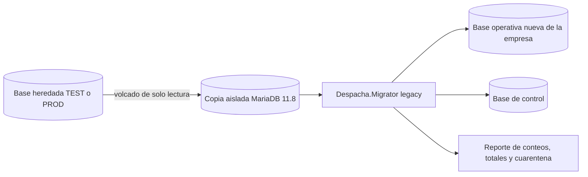

# Estrategia de migración de datos: PHP → .NET

Estado: **Pendiente de aprobación**. Fecha: 2026-10-22.

Se apoya en D-03, D-07 y D-19 de [FASE_2_ARQUITECTURA.md](FASE_2_ARQUITECTURA.md) y en la [matriz de datos](MATRIZ_DATOS_LEGACY_NET.md). Los riesgos están en [RIESGOS_COMPATIBILIDAD_DATOS.md](RIESGOS_COMPATIBILIDAD_DATOS.md).

## 1. Principios

1. **La base heredada nunca se escribe.** El Migrator la lee desde una copia; nunca desde Hostinger en caliente.
2. **Una base operativa nueva por empresa**, creada vacía con `Despacha.Migrator apply` y llenada por la copia. La base de control es aparte.
3. **Repetible y determinista:** cada ejecución borra y recrea **solo la base nueva de destino** y produce el mismo resultado con la misma copia de origen.
4. **Nada se pierde en silencio:** cada fila de origen termina migrada, descartada por una regla escrita, o en cuarentena con motivo.
5. **Trazabilidad:** cada fila nueva conoce su tabla y su id de origen.
6. **Los datos históricos no se "arreglan":** totales, precios y estados se copian como estaban. Las inconsistencias se marcan y se reportan; no se recalculan.

## 2. Decisiones que necesitan aprobación

Antes de implementar hay que cerrar estas decisiones. La recomendación va primero en cada una.

| Id | Tema | Recomendación | Alternativa |
|---|---|---|---|
| D-M1 | Claves del personal | **No migrar ninguna clave.** Cada usuario recibe una activación o un restablecimiento. Respeta "No copiar contraseñas de usuarios del sistema anterior" (Fase 4B) | Lo que dice D-08: convertir a hash las de texto plano y validar las bcrypt en el primer ingreso |
| D-M2 | Roles sin plantilla (`Supervisor`, `Cajero`, valor `2` = "Cliente") | Supervisor y Cajero → rol personalizado por empresa con permisos explícitos; "Cliente" → no es personal, no se migra como usuario | Mapear a Administrador |
| D-M3 | Bar con varios clientes | **Establecimiento conserva `id_bar` y puede tener varios clientes** (relación N a N, o Cliente con `id_establecimiento`) | Duplicar el establecimiento por cada cliente (pierde la relación) |
| D-M4 | Pedidos de clientes borrados | Crear un **cliente histórico inactivo** con el `id_cliente` original, sin datos personales, para no perder pedidos ni totales | Dejar los pedidos en cuarentena |
| D-M5 | `ped_numfac` repetido | Conservar el número original en `numero_legado` y, en los repetidos, usar `numero = ped_numfac + '-' + id_pedido` para el índice único | Excluir el índice único en históricos |
| D-M6 | Pedidos `enviado` antiguos | Pedidos `enviado` con más de N días (a definir) → Entregado con entrega histórica cerrada; los recientes → EnDespacho con entrega abierta | Todos EnDespacho |
| D-M7 | `historial_pedidos` | Usarlo solo para fechar eventos de entrega; el resto queda en el archivo heredado | Crear una entidad nueva de historial de estados del pedido |
| D-M8 | Datos del prototipo (`jornadas`, `visitas`, `jornada_ubicaciones`) | Migrar solo si el negocio confirma que son datos reales; si son de prueba, no migrar | Migrar siempre |
| D-M9 | Líneas cuyo producto o promoción no se puede resolver | Migrar con nombre y precio congelados y la referencia vacía | Cuarentena |

## 3. Paso 0: inspección (antes de implementar)

1. Ejecutar [`database/legacy/inspeccion_solo_lectura.sql`](../database/legacy/inspeccion_solo_lectura.sql) en TEST, idealmente con un usuario MariaDB que solo tenga `SELECT` (la transacción `READ ONLY` del script es una segunda barrera, no la primera). El script no devuelve datos personales ni claves.
2. Con el resultado del bloque A, completar tipos, nulos e índices en la matriz y cerrar los puntos **[?]** (en especial `pedidos.ped_id`, `clientes.id` y `clientes.nombre`).
3. Con los bloques C a G, dimensionar los riesgos (cuántos huérfanos, repetidos, diferencias de totales).
4. Inventario de archivos de imagen: lista de nombres y tamaños de `sistema/assets/img/licores/`, `licores/promos/` y `uploads/` (lectura por FTP o el administrador de archivos). Se cruza con las columnas de imagen.

Necesita autorización: acceso de lectura a TEST y a los archivos de Hostinger.

## 4. Flujo de cada ejecución

1. **Copia de origen.** Volcado lógico consistente (`mysqldump --single-transaction --skip-lock-tables`, que solo lee) de la base heredada. Se registra la fecha, el tamaño y el hash del archivo. La copia contiene datos personales: se guarda cifrada, fuera del repositorio, y se borra al terminar el ciclo de pruebas.
2. **Restauración aislada.** La copia se restaura en un MariaDB 11.8 local o desechable (`despacha_legacy_snap_<fecha>`). Nunca se conecta el Migrator a Hostinger como origen.
3. **Destino limpio.** Se crea `despacha_<empresa>_mig_<ejecución>` y se aplican las migraciones EF con `Despacha.Migrator apply`.
4. **Carga por etapas** (cada etapa es una transacción; si falla, la ejecución se aborta y el destino se descarta):

   | Orden | Etapa | Origen |
   |---|---|---|
   | 1 | Catálogos: medios de pago, estados de caja | `medio_pago`, `estados` |
   | 2 | Categorías | `categorias` |
   | 3 | Productos | `productos` |
   | 4 | Promociones (con producto resuelto) | `promociones` |
   | 5 | Establecimientos | `bares` |
   | 6 | Clientes, contactos, condición de crédito por defecto, clientes históricos (D-M4) | `clientes` |
   | 7 | Personal: usuarios y membresías en control, PersonalEmpresa en la operativa | `users` |
   | 8 | Jornadas, visitas y ubicaciones (si D-M8) | prototipo |
   | 9 | Pedidos (solo filas de pedido) | `pedidos` |
   | 10 | Líneas de pedido, con resolución de producto o promoción | `detalle_pedidos` |
   | 11 | Entregas históricas | pedidos enviados o finalizados |
   | 12 | Caja: caja histórica y movimientos | `pedidos` (filas de caja) |
   | 13 | Saldos iniciales de cartera: factura histórica y cuenta por cobrar | archivo que aporta el negocio |
   | 14 | Consecutivo: inicialización (sección 6) | `pedidos` |

5. **Verificación** (sección 7). Si alguna verificación obligatoria falla, la ejecución queda "rechazada".
6. **Reporte** en Markdown o CSV, solo con conteos, totales e ids; sin nombres, teléfonos ni direcciones.

## 5. Trazabilidad entre ids viejos y nuevos

- **Se conservan los ids** de clientes, bares, categorías, productos, promociones, pedidos y líneas (insertando el valor explícito; los autoincrementales de la base nueva arrancan después del máximo heredado).
- **Ids nuevos** para usuarios (la base de control es compartida), caja, entregas, facturas y todo lo que no existe en PHP.
- En la base operativa, tres tablas técnicas del proceso (no son entidades del dominio y no las usa la aplicación):
  - `legacy_migration_runs`: id de ejecución, hash de la copia de origen, versión del Migrator, inicio, fin y resultado.
  - `legacy_id_map`: entidad, tabla de origen, id de origen, id nuevo, id de ejecución. Una fila por cada fila migrada, incluso cuando el id se conserva.
  - `legacy_quarantine`: tabla de origen, id de origen, regla incumplida y detalle técnico (sin datos personales).
- La correspondencia de usuarios (`users.id` → `StaffUser.Id`) se guarda también en `legacy_id_map` de cada empresa.
- Se pueden borrar con una migración posterior cuando termine el periodo de respaldo.

## 6. Reglas de transformación clave

| Tema | Regla |
|---|---|
| Separar pedidos de caja | Fila de pedido: `ped_numfac` con valor. Fila de caja: `ped_numfac` vacío y `ped_ingreso` o `ped_egreso` distinto de 0. El resto → cuarentena. **Nunca se clasifica por `ped_estado`** |
| Número de pedido y factura | `ped_numfac` → `Pedido.Numero` (D-M5 para repetidos). `ped_factura` → referencia de texto en MovimientoCaja; solo se enlaza a una Factura si el número coincide exactamente |
| Consecutivo | Formato D-12 `PED-AAAAMMDD-####`. El día del corte, el contador arranca después del mayor sufijo heredado de ese día; desde el día siguiente arranca en 1. Como los números heredados eran aleatorios entre 1000 y 9999, no hay choque en otros días: cada día lleva su fecha |
| Estados | Tabla de la matriz (3.8). Valores desconocidos → cuarentena |
| Fechas | A UTC. `ped_fecha` (hora de Colombia, UTC−5 sin horario de verano) + 5 h. `ped_fecha_actualizacion` y `cli_fecha_registro` según `@@time_zone` del servidor (bloque A1) |
| Teléfonos | E.164 `+57`. Repetidos: un contacto por cliente; el teléfono no se marca como único hasta depurar (R-06) |
| Precios y totales | Se copian. `subtotal`, `precio_unitario` y `ped_total` históricos no se recalculan. Las diferencias se marcan en el reporte |
| Líneas de promoción | Resolución por nombre (matriz 3.9). `tipo = promo` solo con evidencia |
| Imágenes | Ruta relativa conservada: `licores/<archivo>` y `licores/promos/<archivo>`. Archivos ausentes se reportan; la fila se migra sin imagen |
| Empresa | `id_empresa` `NULL` o `1` → Empresa A. Otro valor → cuarentena y revisión |
| Datos personales del personal | Se migran nombre, usuario, correo y teléfono. No se migran `direccion`, `password` (D-M1) ni `ops_api_token` |
| `cantidad_venta` | No se migra; si se necesita, se calcula desde las líneas |
| `registro` | No se migra |

## 7. Verificación

Obligatorias (si fallan, la ejecución se rechaza):

| Verificación | Cómo |
|---|---|
| Conteos | Por tabla: filas de origen = migradas + descartadas por regla + cuarentena |
| Ids conservados | Todo id de cliente, producto, promoción, pedido y línea existe en destino con el mismo valor |
| Relaciones | Cero claves foráneas rotas en destino; cada pedido tiene su cliente y sus líneas tienen su pedido |
| Totales de pedidos | Suma de `ped_total` por mes y estado igual en origen y destino |
| Totales de líneas | Suma de `subtotal` y de `cantidad` por mes igual en origen y destino |
| Caja | Suma de ingresos y de egresos por mes y medio de pago igual en origen y destino |
| Números | Cada `ped_numfac` de origen está en `Numero` o en `numero_legado` |
| Repetibilidad | Dos ejecuciones con la misma copia producen el mismo hash de contenido por tabla |
| Sin datos personales en el reporte | Revisión automática del reporte (sin columnas de nombre, teléfono, dirección ni correo) |

De equivalencia (pruebas automáticas sobre la base migrada):

- Muestra fija (semilla) de 50 pedidos: misma fecha, cliente, estado mapeado, total, número de líneas y número de pedido.
- Las consultas del admin PHP (pendientes, aceptados, rechazados por rango de fechas) devuelven los mismos pedidos que las del nuevo sistema, sin contar los que el PHP ocultaba por el `INNER JOIN` con `bares` (se reportan aparte).
- Catálogo: el precio por unidad y por paca de cada producto y promoción activos es igual al del API PHP (`api/productos`, `api/promociones`).
- Un cliente se identifica por teléfono igual que en PHP en todos los casos no repetidos.

De aceptación del negocio: el negocio revisa el reporte de cuarentena, los saldos iniciales cargados y una muestra de pedidos y caja.

## 8. Corte

1. Ensayos completos en TEST hasta tener dos ejecuciones seguidas "aceptadas" y estables.
2. Ventana de corte: PHP pasa a solo lectura (modo mantenimiento en escritura; el webhook de WhatsApp se redirige según la sección 16 de Fase 2).
3. Volcado final de PROD, ejecución completa, verificación y aprobación del negocio.
4. Se activa la nueva plataforma para la Empresa A.

Como el volumen esperado es pequeño, la copia completa en la ventana es más simple y segura que una carga incremental. Se confirma con el tamaño real (bloque A2).

## 9. Reversión

| Momento | Qué se hace | Pérdida |
|---|---|---|
| Antes del corte (ensayos) | Se borra la base de destino de la ejecución. El origen no se tocó | Ninguna |
| Durante la ventana, antes de abrir | Se cancela: PHP vuelve a escritura; la base nueva se descarta | Ninguna |
| Después de abrir, dentro del periodo de respaldo | PHP vuelve a escritura con sus datos tal como quedaron al corte. Los pedidos, entregas y movimientos creados en .NET después del corte se exportan (reporte por id desde `legacy_migration_runs` en adelante) y se registran a mano en PHP | Solo el trabajo posterior al corte, que se recupera a mano |
| Después del periodo de respaldo | No hay reversión a PHP; se corrige hacia adelante | No aplica |

Requisitos: copia de la base heredada al momento del corte guardada y verificada; la base nueva con respaldo diario desde el primer día; un criterio escrito de cuándo se revierte (por ejemplo, no se pueden tomar pedidos durante más de 2 horas).

## 10. Empresa B

- Base operativa propia, creada vacía con `provision-tenant` y `apply`.
- Catálogo y clientes por importación (CSV o plantilla), con las mismas reglas de normalización de esta estrategia.
- Si la inspección muestra filas con `id_empresa` distinto de 1 en la base heredada, se revisan con el negocio antes de decidir si se importan.

## 11. Dónde se implementa

En `Despacha.Migrator`, como comando nuevo (`legacy`) en la fase 11 del plan. Ahora no se implementa nada: este documento solo fija las reglas.
