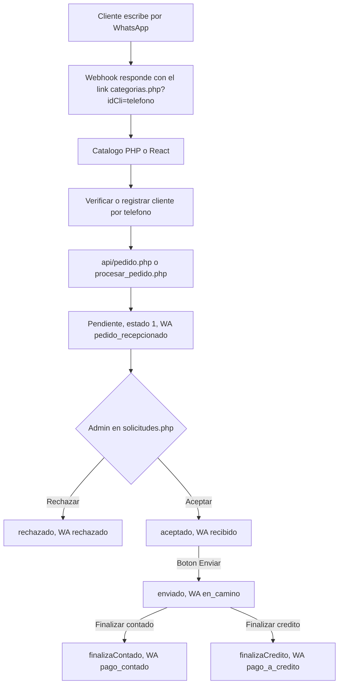

# Fase 1 — Diagnóstico del sistema existente

Fecha: 2026-10-20. Solo lectura: no se modificaron archivos de código ni bases de datos.

**Hallazgo principal:** en el código solo vive la operación de la Empresa A (bodega a bares). Es un PHP sin roles efectivos, sin domiciliario y sin GPS. De la Empresa B (tiendas) solo existe un prototipo de paseador y entregas, que se quitó del repositorio en el commit `0ee81f3` y sigue en el historial (`92be7f2`). Según la documentación, parte de sus tablas ya se crearon en producción.

Marcas usadas:

- **[C]** comprobado en el código.
- **[D]** dicho en la documentación del repositorio, sin verificar en la base.
- **[S]** suposición o propuesta.

> **Atender antes de la fase 2:** la clave de la base de test quedó escrita como valor por defecto en `sistema/config/database.env.php`, que está en git. Junto con el token de Meta, que también está en el código, hay que rotarla.

---

## 1. Estructura actual

| Elemento | Dónde está | Estado |
|---|---|---|
| Repositorio | [SofyMontero/despacha](https://github.com/SofyMontero/despacha), rama `main` | [C] Es el único disponible. No hay otro repositorio de migración. |
| Admin y catálogo PHP | `sistema/` | [C] Es el sistema vivo. Corre en el subdominio `despacha` contra la base de test. |
| API JSON del catálogo | `sistema/api/*.php` | [C] La usa la app React. No tiene autenticación. |
| Catálogo React (PWA y Android con Capacitor) | `catalogo-app/`, publicado en `sistema/app/` | [C] Está construido, pero el cliente sigue viendo el PHP: el interruptor `sistema/config/catalogo.php` está en `'php'`. |
| Prototipo de la Empresa B | Solo en el historial de git, commit `92be7f2` | [C] Se quitó en el commit `0ee81f3`. |
| Ambientes | `sistema/config/database.env.php` | [C] El host `despacha.multilicoreschapinero.com` usa la base `dev`; el dominio principal, `prod`. |

---

## 2. Módulos actuales [C]

| Módulo | Archivos principales | Qué hace |
|---|---|---|
| Login del admin | `index.html`, `controllers/index.php`, `views/header.php`, `controllers/logout.php`, `controllers/session_check.php` | Sesión con `$_SESSION["usuario"]`. La clave se compara en texto plano. |
| Pedidos | `views/solicitudes.php`, `models/solicitudModel.php`, `controllers/pedidoController.php` | Aceptar, rechazar, enviar y finalizar (contado o crédito). Cada paso manda una plantilla de WhatsApp. |
| Catálogo del cliente (PHP) | `views/categorias.php`, `catalogo.php`, `promociones.php`, `procesar_telefono_cliente.php`, `procesar_pedido.php` | El cliente entra con `?idCli=<teléfono>`, arma el carrito y crea el pedido. |
| API del catálogo | `api/categorias`, `productos`, `promociones`, `sugerencias`, `cliente`, `pedido` | El mismo flujo, en JSON, para la app React. |
| Productos | `controllers/ProductoController.php`, `views/Subir_excel_producto.php`, `models/ProductoModel.php` | Alta y edición, importación de precios por CSV e imágenes. |
| Promociones | `controllers/promoController.php`, `models/Promo.php`, `views/promo.php` | Alta y edición, y envío masivo por WhatsApp a todos los clientes. |
| Clientes y bares | `views/clientes.php`, `models/BarModel.php`, `controllers/ajax/*` | Clientes vinculados a un bar. |
| Usuarios | `views/user-*.php`, `controllers/UserController.php`, `models/User.php` | Alta y edición. El rol no se guarda. |
| Caja y cartera | `views/cartera.php`, `controllers/controllerCaja.php` | Ingresos y egresos guardados en la misma tabla `pedidos`, con otras columnas. |
| WhatsApp | `services/enviarWhatsapp.php`, `WhatsappSender.php`, `enviar.php`, `recepcionWhatsapp.php` | Envío de plantillas a Meta y webhook de entrada que responde con el link del catálogo. |
| Código muerto | `Routes/web.php`, `controllers/AuthController.php`, `views/payment.php`, `reservation-*`, `item-*`, `client-list/search/update`, `user-search` | Plantillas sin lógica de negocio, o rotas. |

---

## 3. Inventario de funcionalidades y endpoints

### Admin (requiere sesión) [C]

| Funcionalidad | Entrada | Acción |
|---|---|---|
| Login | POST `controllers/index.php` (`usuario`, `clave`) | `SELECT * FROM users WHERE usuario=?` y comparación en texto plano |
| Listar pedidos por fechas | GET `views/solicitudes.php?fecha_inicio&fecha_fin` | Tres listas: pendientes, aceptados y rechazados, con joins a `clientes` y `bares` |
| Aceptar, rechazar, enviar, finalizar | POST a `views/solicitudes.php` (`action=...`) | `UPDATE pedidos SET ped_estado=...` y la plantilla de WhatsApp correspondiente |
| Ver detalle del pedido | AJAX `pedidoController`, `obtener_productos` | Lee `detalle_pedidos` |
| Productos | `ProductoController` con `accion=crear_producto`, `editar_producto`, `actualizar_precios` y CSV | `productos` |
| Promociones | `promoController` con `action=insert`, `update`, `delete`, `cambiarEstado`, `enviarPromo` | `promociones` y envío masivo |
| Clientes y bares | `views/clientes.php` con `insert`, `update`, `delete` | `clientes`, `bares` |
| Usuarios | `UserController` | `users`, con `password_hash` (que el login no usa) |
| Caja | `views/cartera.php` y `controllerCaja` (JSON) | `pedidos` (columnas de caja), `estados`, `medio_pago` |

### Cliente (sin autenticación) [C]

| Endpoint | Uso |
|---|---|
| GET `api/categorias.php`, `api/productos.php`, `api/promociones.php`, `api/sugerencias.php` | Catálogo |
| GET/POST `api/cliente.php` | Busca o registra un cliente por teléfono; crea el bar si no existe |
| POST `api/pedido.php` | Crea el pedido. El total y los precios **los manda el cliente** y el servidor no los recalcula. |
| `services/recepcionWhatsapp.php` | Webhook de Meta |
| `services/enviarWhatsapp.php` | Envío de plantillas, protegido con un token interno fijo |

---

## 4. Roles [C]

| Rol | Dónde aparece | Comportamiento real |
|---|---|---|
| Administrador, Vendedor, Supervisor, Cajero | Opciones de una lista en `views/user-list.php` | **Ninguno.** No hay reglas por rol y el login no carga el rol. Cualquier usuario que inicie sesión ve y hace todo. |
| Cliente | No es usuario; se identifica por teléfono (`idCli`) | No se autentica. Cualquiera puede pedir a nombre de cualquier número. |
| Paseador, Domiciliario | Solo en la tabla `roles` del prototipo [D] | No existen en el PHP vivo. |

---

## 5. Flujo de pedidos [C]

- El estado se guarda de dos formas: al crear el pedido es el número `1`, y después se escribe como texto (`aceptado`, `enviado`…). Las consultas aceptan ambos.
- No hay entrega como entidad: "Enviar" es solo un botón del admin, sin domiciliario, GPS ni evidencia.
- Tampoco hay factura: `ped_numfac` es un consecutivo `PED-YYYYMMDD-####` que se genera al crear el pedido.
- "Finalizar a crédito" solo cambia el estado; no registra deuda ni abonos. La caja (`cartera.php`) es un módulo aparte.
- Contra duplicados hay un token de sesión y una firma de productos, teléfono y total dentro de una ventana de tiempo.

### Flujo del prototipo de la Empresa B [C en `92be7f2`]

1. El paseador inicia jornada; solo puede tener una `en_curso`.
2. Registra una visita, con o sin pedido.
3. El pedido desde la visita lleva `ped_origen`, `id_visita` y `fecha_entrega_acordada`.
4. El pedido aceptado queda disponible. El domiciliario lo toma o el admin lo asigna.
5. Estados de la entrega: `disponible`, `aceptado`, `salio`, `en_camino` y `entregado`, además de `no_entregado` y `cancelado`.
6. Para que dos domiciliarios no tomen la misma entrega: update condicionado al estado y un índice único por pedido.
7. Al pasar a `salio`, el pedido queda `enviado`.

---

## 6. Tablas

### Negocio actual [C], deducidas del código (no se inspeccionó la base)

| Tabla | Columnas principales | Relación |
|---|---|---|
| `users` | `id, usuario, password, email, telefono, direccion, nombre, rol` | — |
| `clientes` | `id_cliente, cli_identificacion, cli_nombre, cli_telefono, cli_direccion, cli_Bar, cli_zona, cli_fecha_registro` | `cli_Bar` apunta a `bares.id_bar` |
| `bares` | `id_bar, nombre_bar, direccion_bar` | — |
| `pedidos`, columnas del flujo de pedidos | `id_pedido, ped_cliente, ped_estado, ped_fecha, ped_numfac, ped_total, ped_numCliente, ped_observacion, ped_sede` | Apunta a `clientes` |
| `pedidos`, columnas de caja | `ped_id, ped_factura, ped_ingreso, ped_egreso, ped_estado, ped_medio_pago, ped_validado` | Apunta a `estados` y `medio_pago` |
| `detalle_pedidos` | `id_detalle, id_pedido, id_producto, nombre_producto, tipo_producto (unidad o paca), cantidad, precio_unitario, subtotal` | Apunta a `pedidos` |
| `productos` | `id_producto, codigo_productos, descripcion_producto, precio_unidad_producto, precio_paca_producto, cantidad_paca_producto, id_cate_producto, acti_Unidad, imagen_producto, estado_producto, cantidad_venta` | Apunta a `categorias` |
| `categorias` | `id_categoria, nombre_categoria, imagen_categoria` | — |
| `promociones` | `id_promocion, titulo, descripcion, codigo, precio_unidad_producto, precio_paca_producto, acti_Unidad, imagen, estado, prioridad, creado_en` | `codigo` se cruza a veces con `productos.codigo_productos` y a veces con el id |
| `estados` | `estados_id, estado_nombre` | Solo la usa caja |
| `medio_pago` | `md_pago_id, md_pago_nombre` | Solo la usa caja |
| `registro` | `mensaje_recibido, mensaje_enviado, id_wa, timestamp_wa, telefono_wa, fecha_hora` | Bitácora de WhatsApp |
| `historial_pedidos` | `id_pedido, estado_anterior, estado_nuevo, comentario, fecha_cambio` | El código la trata como opcional; no se sabe si existe |

### Prototipo de la Empresa B (commit `92be7f2`)

| Script | Crea o altera | ¿En producción? [D] |
|---|---|---|
| `002_empresas_roles.sql` | `empresas`, `roles (id_rol, rol_nombre, rol_estado)`; en `users`: `id_empresa`, `id_rol`, `ops_api_token`; en `clientes`: `id_empresa` | Ejecutado el 2026-10-11 |
| `003_jornadas_visitas.sql` | `jornadas` (`en_curso` / `finalizada`), `visitas`, `jornada_ubicaciones` | Ejecutado el 2026-10-11 |
| `004_pedido_visita.sql` | En `pedidos`: `ped_origen`, `id_visita`, `fecha_entrega_acordada`, `id_empresa` | Ejecutado el 2026-10-11 |
| `005_entregas.sql` | `entregas` (única por pedido), `entrega_eventos` | **No ejecutado** |

[S] Como la base de test es una copia de producción, es probable que también tenga esas tablas y columnas, aunque ya ningún código las usa.

---

## 7. Integraciones y dependencias [C]

| Integración | Detalle | Riesgo |
|---|---|---|
| WhatsApp Cloud API (Meta Graph v22) | Phone ID (ahora en `WHATSAPP_PHONE_ID`). Plantillas: `pedido_recepcionado`, `recibido`, `rechazado`, `en_camino`, `pago_contado`, `pago_a_credito`, `promocion`, `devuelto`, `servicio`, `promo1` | El token de Meta está escrito en tres archivos |
| Token interno `[REDACTADO]` | Llamadas entre archivos PHP y verificación del webhook | Fijo en el código. El webhook no valida la firma de Meta. |
| Imágenes | `assets/img/licores/`, `licores/promos/`, `uploads/` en el mismo hosting | URLs de producción fijas en el código y en la PWA |
| Composer | `phpoffice/phpspreadsheet ^1.29` declarado | La importación real es por CSV; la librería no se usa |
| Catálogo React | React 19, Vite 8, react-router 7, vite-plugin-pwa, Capacitor 8 (Android `com.monteblanco.multilicores`) | Capacitor carga la URL de producción |
| Hosting | Hostinger, PHP 8.2, MySQL o MariaDB | No hay pruebas automatizadas, CI ni proceso de despliegue |

---

## 8. Matriz de los dos negocios [S]

| Capacidad | Empresa A (bares) | Empresa B (tiendas) | Clasificación |
|---|---|---|---|
| Catálogo, productos y precios por unidad o paca | [C] Existe | Se supone igual | Común |
| Establecimiento (bar o tienda) | [C] Existe como `bares` | Tienda | Común, como establecimiento genérico |
| Aprobación del pedido por el admin | [C] Existe | [C prototipo] La da por hecho | Común |
| Entrega con domiciliario, estados y GPS | No existe; hoy es un botón | [C prototipo] Sin GPS | Común |
| Pedido creado por el cliente vía WhatsApp | [C] Existe | Sin datos | Configurable |
| Promociones y envío masivo | [C] Existe | Sin datos | Configurable |
| Finalizar a contado o a crédito | [C] Existe | Sin datos | Configurable |
| Plantillas de WhatsApp por evento | [C] Existe | Sin datos | Configurable por empresa |
| Pedido del paseador en una visita, con fecha acordada | — | [C prototipo] | Exclusivo de B |
| Jornadas, visitas y recorrido GPS | — | [C prototipo] Sin GPS continuo | Exclusivo de B |
| Vendedor | Solo un nombre en la lista | — | Sin definir |
| Caja y cartera | [C] Existe, aparte | Sin datos | Por decidir |

---

## 9. Riesgos y dependencias

### Seguridad [C]

1. El login compara la clave en texto plano, pero el alta de usuarios la guarda con hash. Un usuario creado desde el admin probablemente no puede entrar. Migrar obliga a rehashear las claves.
2. Hay secretos en el código: el token de Meta, el token interno y las claves de las bases, incluida la de test.
3. Cualquiera puede crear pedidos y clientes a nombre de cualquier teléfono, y fijar los precios y el total del pedido.
4. Varios endpoints del admin no revisan la sesión: `pedidoController`, `promoController`, `ProductoController`, `controllerCaja`.
5. Hay consultas SQL armadas concatenando datos: `WhatsappSender`, `enviar.php` y `ProductoModel::obtenerProductosLista`.

### Datos y negocio

- La tabla `pedidos` mezcla dos esquemas (pedidos y caja) y dos formas de guardar el estado (número y texto).
- Hay tablas de la Empresa B en producción [D] que ya no usa ningún código, y `005` no se ejecutó.
- Hoy no hay concepto de empresa en los datos. Pasar a una base por empresa obliga a decidir qué pasa con las columnas `id_empresa` del prototipo.
- No hay pruebas automatizadas. Para probar equivalencia con PHP hay que escribir antes los casos de prueba.

### Dependencias de orden

- Pedidos depende de clientes, productos y WhatsApp.
- Entregas depende de pedidos aceptados y del rol de domiciliario.
- El GPS depende de jornadas, entregas y la app móvil.
- PHP solo se puede retirar al final, porque el número de WhatsApp de Meta apunta a `recepcionWhatsapp.php`.

---

## 10. Preguntas antes de la fase 2

1. ¿Existe código o base de la Empresa B fuera de este repositorio? ¿Cómo se llama y dónde vive hoy?
2. ¿Se puede obtener la estructura real de `u633742531_Multi_test`, solo las tablas (`SHOW CREATE TABLE`), sin datos?
3. ¿Qué hace hoy el vendedor de la Empresa A?
4. ¿El crédito necesita control de saldos y abonos, o basta con marcarlo? ¿`cartera.php` se sigue usando?
5. ¿`ped_numfac` es la factura real? ¿La factura electrónica DIAN entra en el alcance?
6. En la app nueva, ¿cómo se identifica el cliente: el link de WhatsApp con el teléfono, un código OTP o un login?
7. ¿Dónde va a correr el backend .NET? El hosting compartido de Hostinger no ejecuta .NET, así que haría falta un VPS, Azure u otro servidor. ¿Se pueden crear ahí la base de control y una base por empresa y ambiente?
8. Para los mapas, ¿hay presupuesto para Google Maps o se prefiere OpenStreetMap?
9. ¿Se conserva la app Android de Capacitor o la reemplaza la app Expo?

---

## 11. Orden recomendado de migración [S]

1. **Seguridad inmediata en PHP:** rotar el token de Meta y las claves de las bases, sacar los secretos de git, y que el servidor recalcule precios y total.
2. **Diseño (fase 2):** base de control de empresas, módulos y permisos, con la estructura real de la base y las respuestas de la sección 10.
3. **Base del backend .NET:** identidad (JWT y rehasheo de claves), resolución de la empresa, conexión por ambiente y migraciones controladas.
4. **Catálogo, clientes y productos:** equivalentes a `sistema/api/*` y comparables contra PHP.
5. **Pedidos:** precios calculados en el servidor, aprobación del admin, WhatsApp como notificaciones y estados normalizados.
6. **Entregas y domiciliario,** retomando el diseño del prototipo.
7. **Admin React,** que reemplaza solicitudes, productos, clientes, promociones y usuarios.
8. **Empresa B:** jornadas, visitas y pedido desde la visita, reutilizando el esquema ya creado si se confirma.
9. **App móvil Expo y GPS:** cliente, paseador y domiciliario, con funcionamiento sin conexión.
10. **Retiro de PHP,** con el webhook de WhatsApp al final.

Este orden tiene diez pasos; se ajustará a las 12 fases del proyecto cuando estén definidas.
