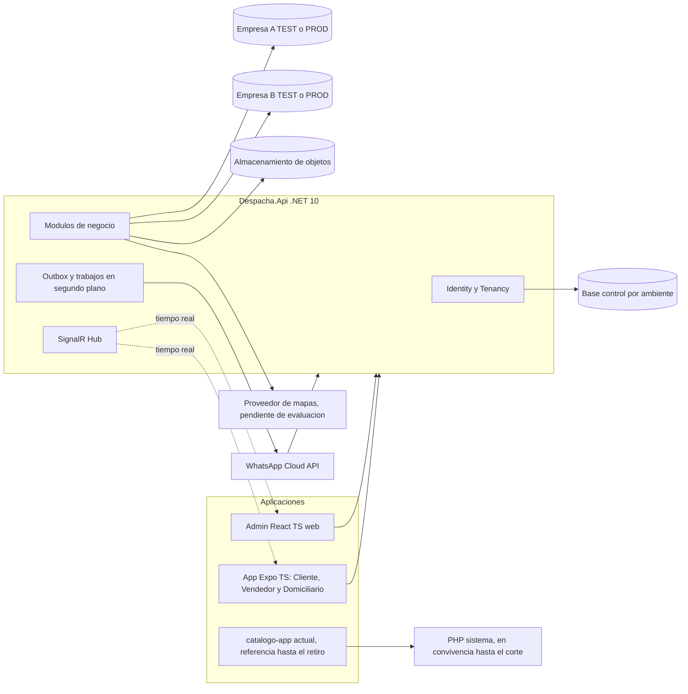
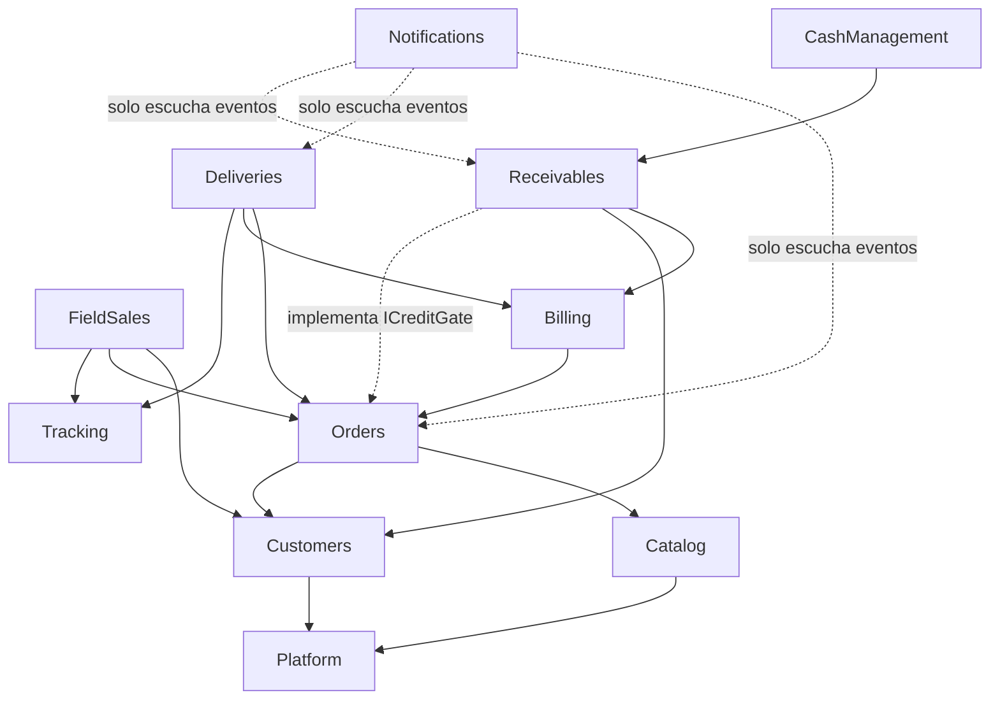
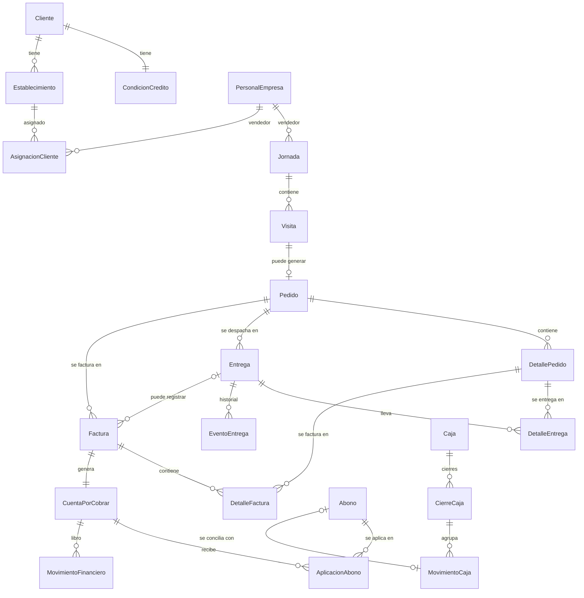
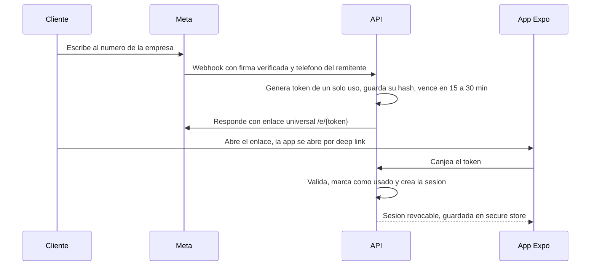
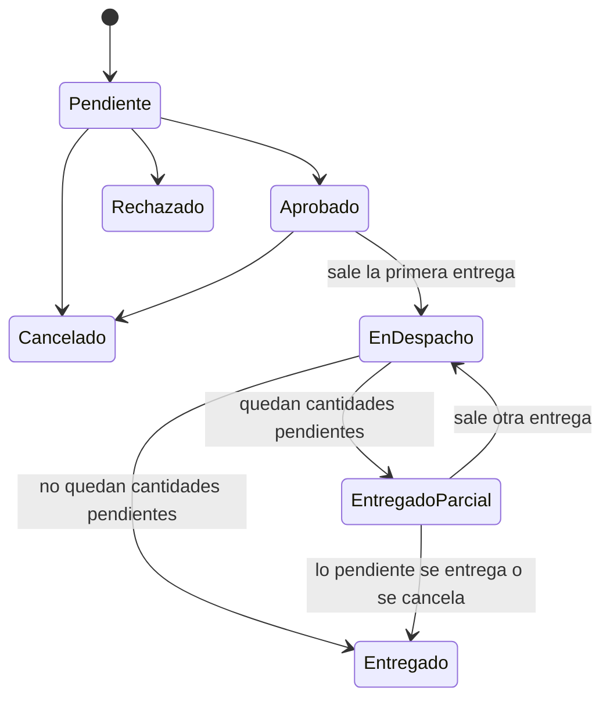
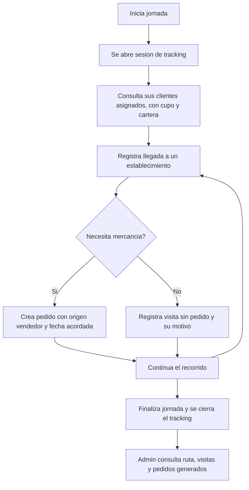
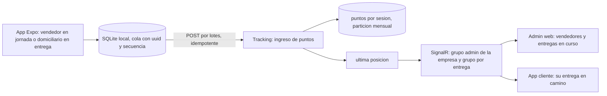

# Fase 2 — Diseño de arquitectura de la nueva plataforma

Versión 1.3, del 2026-10-21. Es un documento de diseño: no se implementó código ni se tocaron bases de datos.

**Estado: FASE 2 APROBADA CON CORRECCIONES DOCUMENTALES.** Esta aprobación no autoriza a iniciar la Fase 3; para eso se necesita una autorización explícita aparte. El acta está en `docs/FASE_2_ACTA_CIERRE.md`.

## Historial de versiones

| Versión | Cambio |
|---|---|
| 1.0 | Diseño inicial |
| 1.1 | Vendedor y Paseador se unifican en el rol **Vendedor**, y `FieldSales` pasa a ser común |
| 1.2 | Correcciones de la aprobación: app Expo + TS para Cliente, Vendedor y Domiciliario; varias facturas y varias entregas por pedido, con control de cantidades; catálogo y pedidos directos también en la Empresa B; módulo `CashManagement`; crédito con cupos, plazos, mora, bloqueos y abonos parciales; consecutivo `PED-AAAAMMDD-####`; proveedor de mapas pendiente de evaluación; retención GPS con objetivo de 90 días |
| 1.3 | Fase 3 replanteada (`docs/FASE_3_CIERRE.md`): el PHP queda solo como referencia y no se corrige; los controles de seguridad pasan a .NET; ajuste del plan de fases. Las decisiones D-00 a D-22 no cambian. |

## Estados de las decisiones

| Estado | Significado |
|---|---|
| **Confirmada** | Decisión de negocio o de producto tomada por el cliente |
| **Aprobada** | Decisión técnica aprobada junto con la arquitectura de la Fase 2 |
| **Recomendada** | Detalle técnico nuevo de la versión 1.2, que se valida en la fase donde se implementa |
| **Pendiente** | Regla operativa o verificación técnica todavía sin resolver (sección 18) |

## Marcas de evidencia

- **[C]** comprobado en el código.
- **[D]** dicho en la documentación del repositorio, sin verificar en la base.
- **[S]** suposición.

"Paseador" solo aparece donde hace falta para explicar o migrar el código y los datos históricos del PHP.

---

## 0. Verificación de la Fase 1 contra el repositorio

| Hallazgo | Resultado |
|---|---|
| Vendedor | [C] En el PHP vivo solo es una opción de una lista en `sistema/views/user-list.php`, sin lógica. Su definición de negocio quedó resuelta en D-00. |
| Paseador (histórico) | [C] Solo existe en el prototipo del commit `92be7f2`: el rol semilla `Paseador` en `002_empresas_roles.sql`, las columnas `id_paseador` de `jornadas` y `visitas`, el origen de pedido `'paseador'` en `PedidoDesdeVisita.php` y `OpsAuth::ROLES_OPS`. |
| `ped_numfac` | [C] Formato `PED-AAAAMMDD-####`, pero el sufijo es **aleatorio** (`rand(1000, 9999)`) y solo reintenta una vez si choca. Es un número de pedido, no una factura. |
| Caja | [C] `controllerCaja.php` inserta filas en `pedidos` con las columnas `ped_factura`, `ped_ingreso`, `ped_egreso`, `ped_medio_pago` y `ped_validado`. `ped_factura` se digita a mano, lo que sugiere que las facturas reales se emiten fuera del sistema. |
| Catálogo | [C] Es JavaScript (`.jsx`). Capacitor 8 está configurado solo para Android y no tiene plugin de geolocalización. Toda la comunicación con el servidor está en `catalogo-app/src/api/client.js`, y la lógica del carrito en `src/context/CartContext.jsx`. |
| Prototipo B | [C] El commit `92be7f2` contiene los SQL 002 a 005 y los módulos Entrega, Jornada, Visita y PedidoOps. Se borró en `0ee81f3`. |
| ¿Las tablas del prototipo existen en la base? | [D] **No verificado** (sección 18). |

---

## 1. Resumen ejecutivo

- **Un backend ASP.NET Core .NET 10**, organizado como monolito modular, con una **base de control por ambiente** y **una base operativa por empresa y ambiente**.
- **Las dos empresas usan las mismas funcionalidades:** catálogo, pedidos directos de clientes, trabajo de calle del Vendedor, entregas, facturación, cartera, caja y GPS. Las diferencias se resuelven con permisos y unas pocas opciones de configuración con nombre. No hay lógica por empresa.
- **Roles oficiales:** Administrador, Vendedor, Domiciliario y Cliente.
- **Clientes:**
  - **Una app React Native + Expo + TypeScript** para Cliente, Vendedor y Domiciliario.
  - **Administración en React web.**
  - El catálogo React actual (`catalogo-app/`) se conserva como referencia y fuente de lógica reutilizable mientras dura la migración.
- **Pedido, Factura, Entrega, Cuenta por cobrar y Movimiento de caja** son entidades separadas.
  - Un pedido puede tener **varias facturas** y **varias entregas**.
  - Las cantidades se controlan por línea.
- **Cartera completa:** cupos, plazos, mora, bloqueos configurables y abonos parciales, más **caja** para ingresos, egresos y conciliación con la cartera.
- **Consecutivo `PED-AAAAMMDD-####`**, generado dentro de una transacción y sin colisiones.
- **GPS:** se envía por HTTP en lotes y SignalR solo lo muestra en vivo. El objetivo de retención es de 90 días, sujeto a revisión legal. El **proveedor de mapas queda pendiente de evaluación**.

---

## 2. Arquitectura general

### D-00 — Un solo rol Vendedor para todas las empresas (Confirmada)

- **Problema:** "Vendedor" y "Paseador" nombraban el mismo concepto, lo que llevaba a duplicar el rol, los permisos, las pantallas y el módulo.
- **Solución:** el único nombre oficial es **Vendedor**, con un rol plantilla, los permisos `fieldSales.*`, una sola experiencia móvil y el módulo `FieldSales` común.
- **Alternativas descartadas:** usar los dos nombres como alias, o tener dos roles.
- **Impacto:** los datos históricos del prototipo se renombran al migrar (sección 16).

### D-01 — Monolito modular en un solo proyecto .NET (Aprobada)

- **Problema:** hay muchos dominios, el equipo es pequeño y no se quiere sobreingeniería.
- **Solución:** `Despacha.Api` contiene el host y las carpetas `Modules/<Modulo>`. Cada módulo tiene sus endpoints, su modelo, su acceso a datos y una interfaz pública. Una prueba de arquitectura impide que un módulo use el código interno de otro.
- **Alternativas:** un proyecto por módulo, Clean Architecture con cuatro capas por módulo, o microservicios.
- **Ventajas:** se navega y se depura fácil, hay un solo despliegue y una sola transacción por base.
- **Desventajas:** los límites se cuidan con pruebas, no con el compilador.

### D-02 — Endpoints mínimos y servicios simples, sin CQRS ni mediador (Aprobada)

- Cada endpoint llama a un servicio del módulo, que usa EF Core.
- Los efectos secundarios (WhatsApp, SignalR, notificaciones) salen por eventos guardados en una tabla de salida (outbox) dentro de la misma transacción.
- **Ventajas:** hay menos archivos, y las notificaciones no se pierden si Meta falla.
- **Desventaja:** necesita un proceso en segundo plano.

---

## 3. Diagrama de componentes



---

## 4. Estructura del monorepo (propuesta, sin crear todavía)

```text
despacha/
  backend/
    Despacha.sln
    src/Despacha.Api/
      Modules/  Platform  Catalog  Customers  Orders  FieldSales
                Billing  Receivables  CashManagement  Deliveries
                Tracking  Notifications
      Integrations/  WhatsApp  Maps  Storage
      Shared/        errores, paginación, reloj, auditoría, consecutivos
    src/Despacha.Migrator/        migraciones por empresa y copia de datos legados
    tests/Despacha.UnitTests/
    tests/Despacha.IntegrationTests/  MySQL real en Testcontainers
    tests/Despacha.ArchitectureTests/ límites entre módulos
  web/admin/                     React + TS + Vite + TanStack Query + Tailwind
  mobile/                        React Native + Expo + TypeScript (una app)
    app/(cliente)/  app/(vendedor)/  app/(domiciliario)/   rutas por experiencia
    src/features/   catálogo, carrito, pedidos, jornada, visitas, entregas, tracking
    src/offline/    cola local SQLite y sincronización
  packages/api-client/           cliente TS generado desde OpenAPI
  packages/shared/               reglas de presentación reutilizables (carrito unidad/paca/promo,
                                 formato de moneda, validaciones), extraídas de catalogo-app
  database/                      documentación del esquema y mapeo de datos legados
  deploy/                        Dockerfile, compose, plantillas de entorno, configuración EAS
  .github/workflows/
  docs/architecture/  docs/adr/  docs/migration/
  catalogo-app/                  referencia y fuente de lógica; se retira al final
  sistema/                       PHP legado, hasta su retiro
```

- **No hay carpetas, proyectos, pantallas ni servicios por empresa.**
- Contratos: el OpenAPI de .NET genera el cliente TypeScript que usan `web/admin` y `mobile`.
- Para los paquetes JavaScript, npm workspaces, sin herramientas adicionales.

---

## 5. Módulos y responsabilidades

| Módulo | Responsabilidad | Uso por empresa |
|---|---|---|
| Platform | Identidad, empresas, membresías, roles, permisos, configuración y auditoría | Común |
| Catalog | Categorías, productos, precios por unidad y por paca, imágenes y promociones | Común (A y B) |
| Customers | Clientes, establecimientos, contactos, direcciones con coordenadas y condiciones de crédito por cliente | Común |
| Orders | Pedidos y detalle, consecutivo `PED-AAAAMMDD-####`, origen (`cliente`, `admin` o `vendedor`), estado logístico calculado a partir de las entregas | Común |
| FieldSales | Jornadas, visitas con o sin pedido, clientes asignados, pedido desde la visita con fecha acordada y ruta realizada | Común |
| Billing | Facturas (registro de facturas emitidas afuera, sin DIAN), **facturación parcial por líneas** | Común |
| Receivables | Cuentas por cobrar, cupos, plazos, mora, bloqueos, abonos parciales, movimientos y ajustes | Común, con políticas configurables |
| CashManagement | Cajas, ingresos, egresos, cierres o arqueos, recaudos en custodia y conciliación con la cartera | Común |
| Deliveries | Entregas múltiples por pedido, detalle con cantidades, asignación, estados, evidencia y novedades | Común |
| Tracking | Sesiones de seguimiento, puntos GPS, última posición y difusión en vivo | Común |
| Notifications | Qué se avisa, a quién y cuándo (plantillas por evento y por empresa) | Común |
| Integrations | Adaptadores de WhatsApp, mapas y almacenamiento; sin lógica de negocio | Infraestructura |

**Fusiones y aplazamientos que se mantienen:**

- Catalog + Products + Promotions forman un solo módulo.
- Customers + Establishments forman un solo módulo.
- FieldVisits va dentro de FieldSales.
- Payments va dentro de Receivables.
- Routes se pospone, porque la ruta realizada ya sale de Tracking.

### Dependencias permitidas



**Reglas:**

- Un módulo solo llama a la interfaz pública de otro.
- Nada depende de Notifications.
- Tracking no conoce ni pedidos ni jornadas, solo sesiones con un tipo y una referencia.
- **Validación de crédito sin ciclos (Recomendada):** Orders define la interfaz `ICreditGate` ("¿este cliente puede comprar a crédito por este valor?") y Receivables la implementa. Así Orders no depende de Receivables y se evita el ciclo Orders → Receivables → Billing → Orders.
- **FieldSales no crea pedidos por su cuenta:** usa el servicio de Orders con `origen=vendedor`.

---

## 6. Matriz de funcionalidades y roles

### Funcionalidades por empresa

| Función | Empresa A | Empresa B | Variación |
|---|---|---|---|
| Catálogo y pedido directo del cliente | Sí | Sí | Ninguna |
| Promociones y envío masivo | Sí | Sí | Ninguna |
| Aprobación del pedido por el admin | Sí | Sí | Opción `orders.requireApproval` |
| Vendedor: jornadas, visitas, GPS, clientes asignados, pedido en visita | Sí | Sí | Ninguna |
| Facturas, incluida la facturación parcial | Sí | Sí | Quién registra: permiso `billing.register` |
| Crédito y cartera | Sí | Sí | Políticas `credit.*` |
| Caja y conciliación | Sí | Sí | Ninguna |
| Entregas múltiples con domiciliario | Sí | Sí | Opción `deliveries.assignmentMode` (autoasignación, la asigna el admin, o ambas) |
| GPS de entrega y vista del cliente | Sí | Sí | Opción `tracking.customerView` |

### Opciones de configuración por empresa

La lista está cerrada: no se agrega una opción sin una diferencia real de negocio.

| Clave | Para qué |
|---|---|
| `orders.requireApproval` | El pedido necesita aprobación del administrador |
| `deliveries.assignmentMode` | Cómo se asignan las entregas |
| `tracking.customerView` | El cliente ve al domiciliario en camino |
| `credit.defaultLimit`, `credit.defaultTermDays` | Cupo y plazo por defecto |
| `credit.blockOnLimitExceeded` | Qué pasa si se excede el cupo: `bloquear`, `advertir` o `requiere_aprobacion` |
| `credit.blockOnOverdueDays` | Días de mora a partir de los cuales se aplica el bloqueo, y con qué acción |
| `credit.lateInterest` | Si se calcula interés de mora (desactivado mientras la regla siga pendiente) |

### Roles oficiales (plantillas iguales en todas las empresas)

| Rol | Identidad | Experiencia | Permisos base |
|---|---|---|---|
| Administrador | Membresía en la base de control | Admin web | Todos los de los módulos activos |
| Vendedor | Membresía en la base de control | App Expo, rutas `(vendedor)` | `fieldSales.workday.manage`, `fieldSales.visit.create`, `fieldSales.order.create`, `customers.read.assigned`, `catalog.read`, `tracking.report`, `receivables.read.assigned` |
| Domiciliario | Membresía en la base de control | App Expo, rutas `(domiciliario)` | `deliveries.read.own`, `deliveries.claim`, `deliveries.updateStatus`, `deliveries.evidence`, `tracking.report`; y opcionalmente `billing.register` y `receivables.payment.collect` |
| Cliente | Sesión de cliente en la base de la empresa; no es personal | App Expo, rutas `(cliente)` | Su catálogo, sus pedidos, sus entregas en curso, su cartera y su cupo disponible |

**Permisos de administración por módulo:**

| Módulo | Permisos |
|---|---|
| Orders | `orders.approve`, `orders.cancel` |
| FieldSales | `fieldSales.assignCustomers`, `fieldSales.workday.readAll`, `fieldSales.route.read` |
| Deliveries | `deliveries.plan` (dividir un pedido en entregas), `deliveries.assign` |
| Billing | `billing.register`, `billing.void` |
| Receivables | `receivables.credit.manage` (cupos, plazos y bloqueos), `receivables.credit.override` (aprobar excepciones), `receivables.payment.register`, `receivables.adjust` |
| CashManagement | `cash.movement.create`, `cash.movement.validate`, `cash.close`, `cash.reconcile` |

Una empresa puede ajustar los permisos de sus roles, pero los nombres de los roles plantilla son iguales en todas.

---

## 7. Diseño multi-tenant

### D-03 — Base central de control por ambiente (Aprobada)

- `control_test` y `control_prod` contienen las tablas Tenant, TenantDatabase (servidor, base y **referencia** al secreto), Usuario, Membresía, Rol, Permiso, TenantModule, TenantSetting y auditoría de plataforma.
- **Ventajas:** sumar una empresa se vuelve una operación de datos, y un usuario puede pertenecer a varias empresas.
- **Desventaja:** agrega una base más que respaldar.

### D-04 — El ambiente lo decide el despliegue (Aprobada)

El despliegue de TEST solo tiene la conexión de `control_test` y los secretos de TEST. Ningún parámetro del cliente cambia el ambiente.

### D-05 — Cómo se identifica la empresa en cada solicitud (Aprobada)

- **Personal:** inicia sesión, elige empresa y recibe un token JWT con `tid`. El servidor revalida la membresía, y cambiar de empresa emite un token nuevo.
- **Cliente:** la empresa va en su token de enlace o de sesión.
- **Webhook de WhatsApp:** la empresa sale del `phone_number_id`, mapeado en la base de control.
- **Anónimo,** si se permite ver el catálogo sin sesión: la empresa sale del dominio o del identificador público de la app.
- **Nunca** se acepta un encabezado `X-Tenant` libre.

### D-06 — Credenciales (Aprobada)

Los secretos viven en el gestor de secretos o en variables de entorno. La base de control solo guarda el nombre del secreto, y cada empresa tiene su propio usuario de base de datos.

### D-07 — Migraciones por empresa (Aprobada)

- EF Core genera un script SQL que se revisa y se puede volver a ejecutar sin daño.
- Se aplica primero en TEST y luego en PROD, con aprobación manual.
- Si falla una empresa, no bloquea a las demás.
- La API nunca migra al arrancar.

### Personal en varias empresas

- Hay una identidad global y una membresía con rol por cada empresa.
- Un Vendedor o un Domiciliario puede trabajar en A y en B con una sola cuenta.
- Cada jornada, visita, pedido, entrega, abono y punto GPS se guarda **solo en la base de la empresa activa**.
- Hay que cerrar la jornada antes de cambiar de empresa.
- Cada base de empresa guarda `PersonalEmpresa`, una copia mínima del personal para reportes, sin claves foráneas hacia la base de control.

### Incorporar una empresa nueva

Registro en la base de control, creación de la base, migraciones, datos iniciales (roles plantilla y configuración), activación de módulos y primer administrador.

---

## 8. Modelo de datos preliminar

### Base de control

| Entidad | Contenido clave | Restricciones |
|---|---|---|
| Tenant | id, código, nombre, dominios, estado | El código es único |
| TenantDatabase | id_tenant, servidor, base, referencia al secreto | Una por empresa en cada ambiente |
| Usuario | id, login, hash de la clave, estado, intentos | El login es único |
| Membresía | usuario, empresa, rol, estado | Única por usuario y empresa |
| Rol | empresa, nombre (`Administrador`, `Vendedor`, `Domiciliario`), si es plantilla | Único por empresa y nombre |
| Permiso / RolPermiso | código | Catálogo fijo en el código |
| TenantModule / TenantSetting | empresa, módulo o clave, valor tipado | Solo las claves de la sección 6 |

### Base de cada empresa

| Entidad | Módulo | Relaciones y reglas | Origen PHP o prototipo |
|---|---|---|---|
| PersonalEmpresa | Platform | Copia mínima del usuario global | `users` (parcial) |
| Cliente | Customers | Tiene contactos (N) y establecimientos (N) | `clientes` |
| CondicionCredito | Customers | Una por cliente: cupo, plazo en días, bloqueado manualmente, motivo y fecha | Nuevo |
| ContactoCliente | Customers | Teléfono en formato E.164 | `cli_telefono` |
| Establecimiento | Customers | Cliente, dirección, coordenadas y zona | `bares` y `cli_Bar` |
| Categoría / Producto / Promoción | Catalog | Producto con precio por unidad y por paca y unidades por paca | `categorias`, `productos`, `promociones` |
| Pedido | Orders | Número `PED-AAAAMMDD-####` único, cliente, establecimiento, origen, `id_vendedor` y `id_visita` opcionales, fecha acordada, condición de pago solicitada, estado | `pedidos` (columnas de pedido) |
| DetallePedido | Orders | Producto, tipo (unidad, paca o promo), **cantidad pedida**, precio congelado por el servidor | `detalle_pedidos` |
| Consecutivo | Shared | Clave `(tipo, fecha)` y último valor | Nuevo |
| AsignacionCliente | FieldSales | Vendedor a establecimiento, N a N, con vigencia | Nuevo |
| Jornada | FieldSales | `id_vendedor`, N visitas, 1 sesión de tracking | Prototipo `jornadas` (`id_paseador`) |
| Visita | FieldSales | Jornada, vendedor, establecimiento, llegada, resultado y 0 o 1 pedido | Prototipo `visitas` (`id_paseador`) |
| Entrega | Deliveries | **N por pedido.** Domiciliario, fecha programada, estado, evidencia | Prototipo `entregas` (allí era única por pedido; deja de serlo) |
| DetalleEntrega | Deliveries | Entrega y DetallePedido: **cantidad programada, entregada y no entregada, con motivo** | Nuevo |
| EventoEntrega | Deliveries | Cambio de estado con fecha, usuario y ubicación opcional | Prototipo `entrega_eventos` |
| Factura | Billing | **N por pedido.** Número externo único por empresa, fecha, condición (contado o crédito), `id_entrega` opcional, estado (vigente o anulada) | Nuevo; `ped_factura` como referencia histórica |
| DetalleFactura | Billing | Factura y DetallePedido: cantidad facturada, precio del pedido, subtotal | Nuevo |
| CuentaPorCobrar | Receivables | 1 por factura: cliente, valor, vencimiento (fecha de la factura más el plazo) y estado | Nuevo |
| Abono | Receivables | Valor, medio de pago, recibido por, estado de custodia; se aplica a una o varias cuentas mediante AplicacionAbono | Nuevo |
| AplicacionAbono | Receivables | Abono, cuenta por cobrar y valor aplicado (permite pagos parciales y repartidos) | Nuevo |
| MovimientoFinanciero | Receivables | Libro que solo se agrega: cargo, abono, ajuste o anulación, con usuario y motivo | Nuevo |
| Caja | CashManagement | Punto de caja: nombre y estado | Nuevo |
| CierreCaja | CashManagement | Caja, periodo, saldo inicial, ingresos, egresos, saldo contado, diferencia, estado y quién cerró | Nuevo |
| MovimientoCaja | CashManagement | Ingreso o egreso, concepto, medio, valor, validado por, `id_abono` opcional; anular es crear un movimiento contrario | Columnas de caja de `pedidos` (`ped_ingreso`, `ped_egreso`, `ped_medio_pago`, `ped_validado`) |
| SesiónTracking / PuntoUbicación | Tracking | Sesión de tipo jornada o entrega; N puntos | Prototipo `jornada_ubicaciones` |



### Invariantes de cantidades (D-20, Confirmada)

- **Entregas:** por cada línea del pedido, la suma de lo programado en entregas activas, menos lo no entregado, no puede superar la cantidad pedida. Lo no entregado vuelve a quedar pendiente: se puede reprogramar en otra entrega o cancelar.
- **Facturas:** por cada línea, la suma de lo facturado en facturas vigentes no puede superar el tope. Si el tope es la cantidad pedida o la entregada es una regla pendiente (sección 18).
- **Unidad:** las cantidades se expresan en la unidad de la línea (unidad, paca o promo), sin conversiones.
- **Concurrencia:** las validaciones se hacen dentro de una transacción que bloquea la fila del pedido (`SELECT … FOR UPDATE`), para que dos facturas o entregas simultáneas no superen el tope.

### Identificadores

- Las claves internas son `BIGINT` autoincrementales.
- Los números visibles (pedido y factura) son campos aparte con índice único.
- Se conservan los id legados de clientes, productos y pedidos.

---

## 9. Autenticación y permisos

### D-08 — Personal (Aprobada)

- Usuario y clave con el `PasswordHasher` de ASP.NET Core Identity.
- Token JWT de unos 15 minutos y token de renovación rotativo, guardado con hash y revocable.
- En la app, los tokens se guardan en `expo-secure-store`.
- Las claves legadas se convierten a hash al migrar (las de texto plano) o en el primer ingreso (las de bcrypt).

### D-09 — Cliente con acceso desde WhatsApp (Aprobada; actualizada para Expo)



- Se confía en el teléfono que **Meta entrega en el webhook**, nunca en uno que venga en la URL.
- El token es opaco, guardado con hash, de un solo uso, con vencimiento y revocable.
- **Si la app no está instalada (Recomendada):** el enlace abre una página web que lleva a la tienda de apps y conserva el token para canjearlo después de instalar.
  - La opción de publicar como web el flujo de cliente de la misma app Expo se evalúa en la Fase 6.
  - Mientras tanto, el catálogo actual sigue atendiendo hasta el corte.
- Las acciones sensibles (cambiar dirección, ver la cartera) piden verificación adicional con un código por plantilla de autenticación de WhatsApp.
- Hay límite de intentos por teléfono y por IP.

### D-10 — Permisos (Aprobada)

- Cada endpoint exige el módulo activo, el permiso y el alcance de los datos. Por ejemplo, el Vendedor ve sus clientes asignados, el Domiciliario sus entregas y el Cliente solo lo suyo.
- Los endpoints, servicios y pantallas son los mismos para todas las empresas.

---

## 10. Pedidos, facturas, cartera y caja

### Tres estados independientes

| Dimensión | Dónde vive | Valores |
|---|---|---|
| Logística | Pedido (calculado a partir de sus entregas) | Pendiente, Aprobado, Rechazado, EnDespacho, EntregadoParcial, Entregado, Cancelado |
| Facturación | Pedido (calculado a partir de sus facturas) | SinFacturar, FacturadoParcial, Facturado |
| Financiero | Cada cuenta por cobrar | Vigente, Vencida, Pagada, Anulada |



| Estado PHP | Estado nuevo |
|---|---|
| `1` y `pendiente` | Pendiente |
| `aceptado` | Aprobado |
| `rechazado` | Rechazado |
| `enviado` | EnDespacho |
| `finalizaContado` y `finalizaCredito` | Entregado, con la condición de pago correspondiente (ver la migración en la sección 16) |

### D-11 — El servidor calcula los precios y el total (Confirmada)

Del cliente o del vendedor solo se reciben el producto, el tipo y la cantidad.

### D-12 — Consecutivo de pedido `PED-AAAAMMDD-####` (Confirmada; detalle técnico Recomendado)

- **Formato:** se mantiene. `AAAAMMDD` es la fecha de creación en hora de Colombia (`America/Bogota`), y `####` es un consecutivo del día que empieza en `0001`.
- **Generación dentro de una transacción:**
  - En la misma transacción que inserta el pedido, se incrementa la fila `Consecutivo(tipo='pedido', fecha)` de forma atómica (`UPDATE … SET valor = LAST_INSERT_ID(valor + 1)`) o bloqueándola con `SELECT … FOR UPDATE`.
  - Si la transacción falla, el número no se consume; puede haber huecos solo por reversiones, y se aceptan.
- **Prevención de colisiones:**
  - Índice único sobre el número del pedido.
  - El contador vive en la base de cada empresa, así que dos empresas pueden repetir número sin conflicto.
- **Límite de cuatro dígitos (9.999 por día):** el sufijo usa al menos cuatro dígitos y **crece a cinco si se supera** (`PED-20261020-10000`). No se rechazan pedidos y el orden se mantiene. Hay una alerta operativa al llegar a 8.000 en un día.
- **Corte con los números legados:**
  - Los pedidos migrados conservan su número aleatorio.
  - El día del corte, el contador de esa fecha arranca en el sufijo legado más alto de ese día.
  - El índice único es la última protección.
- **Pedidos creados sin conexión por el vendedor:** el número se asigna al sincronizar, no en el teléfono. El teléfono manda una clave UUID para que el mismo pedido no se cree dos veces.

### D-13 — Facturas, varias por pedido (Confirmada)

- Una factura registra una factura emitida fuera del sistema, sin DIAN. El número es único por empresa.
- **Facturación parcial:** cada factura tiene líneas (`DetalleFactura`) contra las líneas del pedido, con su cantidad. Se respeta el tope de la sección 8.
- La puede registrar el administrador, o el domiciliario durante una entrega (`id_entrega`), si tiene el permiso `billing.register`.
- **Anulación:** solo con `billing.void`, con motivo. Se reversa la cuenta por cobrar con un movimiento de anulación y se liberan las cantidades facturadas.

### D-14 — Crédito y cartera (Confirmada)

- **Una cuenta por cobrar por factura.** Si es de contado, el abono se registra al mismo tiempo y la cuenta queda pagada.
- **Cupo:** `CondicionCredito.cupo`, o `credit.defaultLimit` si no tiene uno propio. Cupo disponible = cupo − saldo pendiente de las cuentas por cobrar (si los pedidos aprobados sin facturar también consumen cupo es una regla pendiente).
- **Plazo:** el del cliente, o `credit.defaultTermDays`. El vencimiento es la fecha de la factura más el plazo.
- **Mora:** una cuenta pasa a Vencida cuando se cumple el vencimiento y sigue con saldo. Los días de mora se calculan a diario. El interés de mora es opcional (`credit.lateInterest`) y queda apagado mientras la regla esté pendiente.
- **Bloqueos configurables:**
  - Se evalúan al crear un pedido a crédito y al aprobarlo, mediante `ICreditGate`.
  - **Causas:** cupo excedido (`credit.blockOnLimitExceeded`), mora mayor a N días (`credit.blockOnOverdueDays`) o bloqueo manual del cliente.
  - **Acciones:** `bloquear`, `advertir` o `requiere_aprobacion`. Una excepción la aprueba alguien con `receivables.credit.override` y queda auditada.
- **Abonos parciales:**
  - Un abono puede cubrir parte de una cuenta o repartirse entre varias (`AplicacionAbono`).
  - Si no se indica la cuenta, se aplica primero a la más antigua (Recomendada).
- **Libro inmutable:** no se edita ni se borra nada. Los ajustes y anulaciones son movimientos nuevos, con permiso, motivo y auditoría.

### D-21 — Caja (`CashManagement`) (Confirmada)

- **Ingresos y egresos:** `MovimientoCaja` con concepto, medio de pago, valor, usuario y validación. Para anular, se registra un movimiento contrario.
- **Cierre o arqueo:** `CierreCaja` compara el saldo teórico con el contado y registra la diferencia.
- **Conciliación con la cartera:**
  - El abono que recibe en efectivo un domiciliario o un vendedor queda "en custodia" de esa persona.
  - Cuando entrega el dinero en caja, se registra un ingreso enlazado al abono y este queda "consignado".
  - El reporte de conciliación muestra, por persona y por día, los abonos registrados frente al dinero entregado en caja, y los que siguen pendientes.
  - Los medios no efectivos (transferencias) aparecen como "por confirmar" hasta que caja los valida.
- **Separación de responsabilidades:** la cartera dice cuánto debe el cliente; la caja dice dónde está el dinero. Ninguna reemplaza a la otra.

---

## 11. Trabajo del vendedor y entregas

### Flujo del Vendedor (común)



- La jornada tiene estados `en_curso` y `finalizada`, con una sola abierta por vendedor en cada empresa.
- La visita se puede registrar **con o sin pedido**, y aunque no haya GPS.
- Si el pedido es a crédito, `ICreditGate` informa al vendedor si hay bloqueo o advertencia.
- **Sin conexión:** el catálogo, los clientes asignados y los pedidos pendientes se guardan en SQLite local. Al sincronizar, el servidor recalcula los precios (sección 18: qué precio vale si cambió entretanto).

### Entregas múltiples

- **Planificación:** cuando se aprueba el pedido se crea una entrega por el total con la fecha acordada. Con `deliveries.plan`, el administrador puede dividir el pedido en varias entregas por línea y cantidad.
- **Estados de la entrega:** disponible, asignada, aceptada, salió, en camino, entregada, no entregada y cancelada.
  - Solo un domiciliario puede tomar cada entrega: la actualización exige que siga disponible.
  - El índice único por pedido del prototipo **se elimina**, porque ahora un pedido tiene varias entregas.
- **Confirmación:** el domiciliario registra lo entregado y lo no entregado de cada línea, con motivo. Lo no entregado vuelve a quedar pendiente.
- **Registro de factura y cobro en la entrega:** con los permisos que corresponden, el domiciliario registra el número de factura de lo entregado y el abono que recibió.
- **Evidencia:** foto y opcionalmente firma, en el almacenamiento de objetos.

---

## 12. Arquitectura GPS



### D-15 — HTTP para guardar, SignalR solo para mostrar (Aprobada)

- Cada punto lleva un UUID generado en el teléfono. El servidor ignora los repetidos y guarda los que llegan tarde con su hora original.
- SignalR solo reparte la última posición. Si se cae, el mapa consulta por HTTP.
- Es la misma infraestructura para jornadas y para entregas.

### Parámetros iniciales (ajustables)

| Caso | Frecuencia |
|---|---|
| Vendedor en jornada | Un punto cada 60 s o cada 50 m |
| Domiciliario "en camino" | Un punto cada 10 a 15 s |
| Sin jornada ni entrega activa | No se registra nada |

### D-22 — Retención (Confirmada como objetivo)

- **Los puntos detallados se guardan 90 días**, sujeto a revisión legal y de privacidad (Ley 1581 de 2012).
- Después se conserva el resumen de la ruta (trazo simplificado y distancia) dentro de la jornada o la entrega.
- La depuración de puntos se hace por partición mensual.

### Privacidad y fallos

- Consentimiento explícito en la app y aviso visible mientras se registra la ubicación.
- El cliente solo ve al domiciliario de su entrega mientras está en camino. La ubicación del vendedor solo la ve el administrador de esa empresa.
- Los estados manuales y el registro de visitas no dependen del GPS.
- Con varias instancias de la API, SignalR necesita un backplane (Redis o un servicio gestionado). Se pospone.

---

## 13. Aplicación móvil

### D-16 — React Native + Expo + TypeScript para Cliente, Vendedor y Domiciliario (Confirmada)

- **Problema:** se necesita GPS en segundo plano, funcionamiento sin conexión, Android e iOS, y una sola experiencia por rol.
- **Solución:**
  - **Una app Expo** en `mobile/`, con rutas por experiencia: `(cliente)`, `(vendedor)` y `(domiciliario)`. La que se muestra depende del tipo de sesión y de los permisos, nunca de la empresa (Recomendada).
  - Si después se necesitan dos fichas distintas en las tiendas de apps (cliente y personal), se generan desde el mismo código con variantes de compilación, sin duplicarlo.
- **La administración se queda en React web** (`web/admin`).
- **`catalogo-app/`:**
  - Sigue en producción contra PHP hasta el corte, y es la referencia funcional.
  - Su lógica reutilizable (cálculo del carrito por unidad, paca y promoción, formato de precios, validaciones del checkout) se pasa a TypeScript en `packages/shared`.
  - La interfaz se reescribe en React Native.
  - Su envoltorio Capacitor para Android se retira cuando la app Expo esté publicada.
- **Capacidades técnicas:**
  - GPS en segundo plano con `expo-location` + `expo-task-manager`, o una librería comercial si las pruebas lo exigen.
  - Sin conexión con `expo-sqlite`.
  - Compilación en la nube con EAS, que también permite iOS sin Mac.
- **Limitaciones del sistema operativo:**
  - Android exige un servicio en primer plano con notificación visible.
  - iOS exige el permiso de ubicación "siempre", con su justificación ante Apple.
  - Hay que medir la batería en equipos reales de gama media.

Comparación que llevó a esta decisión:

| Criterio | Capacitor | Expo |
|---|---|---|
| Reutilización del catálogo | Alta en la interfaz | La lógica en TS se reutiliza; la interfaz se reescribe |
| GPS en segundo plano | Plugins menos maduros | Soportado de forma oficial |
| iOS | No está configurado | Con EAS |
| Funcionamiento sin conexión | Por plugin | `expo-sqlite` integrado |
| Costo | Bajo, pero limitado para el personal | Medio, con una sola base de código para todos los roles |

---

## 14. Mapas

### D-17 — Proveedor de mapas pendiente de evaluación (Pendiente; verificación técnica)

- **Google Maps no está aprobado como proveedor definitivo.** Ningún proveedor está elegido.
- **La arquitectura no depende del proveedor:** todo el uso pasa por el adaptador `Integrations/Maps`, que cubre mapa, geocodificación, rutas y tiempo de llegada. En el móvil se usa un componente de mapa que se puede cambiar.
- **Proveedores a evaluar:**
  - Google Maps Platform.
  - Mapbox.
  - MapLibre con teselas de un proveedor compatible con OSM (MapTiler o Stadia), y geocodificación y rutas de un proveedor o propias (OpenRouteService, OSRM, GraphHopper o Valhalla).
  - Las teselas de `tile.openstreetmap.org` y el Nominatim público **no** sirven para producción.
- **Criterios de evaluación:**
  - Calidad de geocodificación con direcciones colombianas reales de la base de test ("Cl 45 # 12-30").
  - Costo con el volumen esperado.
  - Licencia para uso comercial y para guardar coordenadas.
  - SDK móvil para Expo y mapa web.
  - Rutas y tiempo de llegada.
  - Límites de consumo.
- **Mientras no se decida:**
  - El establecimiento guarda las coordenadas que confirma el usuario al poner el pin.
  - El tiempo de llegada se estima por distancia.

---

## 15. Infraestructura y despliegues

### D-18 — Infraestructura independiente del proveedor (Aprobada; el proveedor queda Pendiente)

| Componente | Propuesta |
|---|---|
| API | Contenedor Docker en un VPS o en una plataforma gestionada |
| Admin web | Archivos estáticos detrás de una CDN, o servidos por la API |
| App móvil | EAS Build y Submit; cuentas de Google Play y Apple Developer; actualizaciones por EAS Update con un canal para TEST y otro para PROD |
| Bases | **MariaDB 11.8.9** (motor de referencia, confirmado en Hostinger: `11.8.9-MariaDB-log`), con respaldo diario por base y prueba de restauración mensual |
| Secretos | Gestor del proveedor o variables de entorno; nunca en git |
| Archivos | Almacenamiento compatible con S3 |
| Logs | Serilog estructurado, sin datos personales ni tokens |
| HTTPS | El del proveedor, o Let's Encrypt |
| CI/CD | GitHub Actions: compilar y probar; desplegar a TEST desde `main`; a PROD por etiqueta y con aprobación manual |

---

## 16. Migración de PHP a .NET

### D-19 — Esquema limpio y copia repetible, con corte por ventana (Aprobada)

- Una base nueva para la Empresa A en TEST y en PROD.
- El proceso de copia y transformación (`Despacha.Migrator`) se ejecuta muchas veces en TEST contra la copia de producción.
- El corte se hace en una ventana corta, y PHP queda en modo solo lectura como respaldo durante algunas semanas.

### Qué pasa con cada pieza

| Pieza | Qué se hace |
|---|---|
| `catalogo-app/` | Sigue en producción contra PHP hasta el corte. Su lógica pasa a `packages/shared` y su interfaz se reescribe en Expo, en las rutas `(cliente)`. Se retira con Capacitor al final. |
| API y admin PHP | Se reescriben; la lógica se toma como especificación |
| Usuarios | Se convierten las claves a hash. Las membresías se crean con los roles oficiales: el valor `Vendedor` de `users.rol` pasa a Vendedor. |
| Clientes y bares | Se normalizan los teléfonos y se separan cliente y establecimiento. Se crea una `CondicionCredito` con los valores por defecto. |
| Productos y promociones | Se copian conservando los id |
| Pedidos | Se conservan los id y el `ped_numfac`, y se mapean los estados |
| Entregas históricas | Cada pedido `enviado` o finalizado genera una entrega histórica, cerrada, por el total |
| Facturas y cartera históricas | El PHP no registra facturas ni abonos (ver la nota debajo) |
| Caja | Las filas de `pedidos` con columnas de caja pasan a `MovimientoCaja`, con `ped_factura` como referencia de texto. No se enlazan a facturas a menos que el número coincida. |
| Imágenes | Se copian al almacenamiento de objetos conservando la ruta relativa |
| Empresa B | Su base arranca limpia. El catálogo y los clientes iniciales se cargan por importación (CSV o plantilla), sin migrar desde PHP. |

**Facturas y cartera históricas:** como el PHP no registra ni facturas reales ni abonos, la cartera viva se carga con un **saldo inicial por cliente** que aporta el negocio. Cada saldo crea una factura histórica marcada como tal, con su cuenta por cobrar. Los pedidos `finalizaCredito` sirven solo como referencia para revisar ese saldo.

### Mapeo histórico de "Paseador" a "Vendedor"

Solo aplica si se confirma que las tablas del prototipo existen y tienen datos.

| Origen histórico | Destino |
|---|---|
| Fila `Paseador` en `roles` | Rol plantilla Vendedor (no se crea la fila `Paseador`) |
| `users.id_rol` apuntando a `Paseador` | Membresía con rol Vendedor |
| `jornadas.id_paseador`, `visitas.id_paseador` | `Jornada.id_vendedor`, `Visita.id_vendedor` |
| `pedidos.ped_origen = 'paseador'` | `Pedido.origen = vendedor`, con `id_vendedor` tomado de la visita |
| `'paseador'` en `OpsAuth::ROLES_OPS` | Sin destino; era código del prototipo, ya retirado |

### Pruebas de equivalencia y de reglas nuevas

- **Escenarios de PHP:**
  - pedido con unidad, paca y promoción;
  - total calculado;
  - transiciones de estado;
  - plantilla de WhatsApp en cada paso.
- **Consecutivo:**
  - pedidos concurrentes sin números repetidos;
  - paso de 9.999 a 10.000;
  - arranque del contador el día del corte.
- **Entregas y facturas parciales:**
  - no se puede pasar el tope;
  - lo no entregado vuelve a quedar pendiente;
  - al anular una factura se liberan sus cantidades.
- **Crédito:**
  - bloqueo por cupo y por mora con cada acción;
  - excepción aprobada y auditada;
  - abono repartido entre varias cuentas.
- **Caja:** recaudo en custodia, consignación y reporte de conciliación.
- **Vendedor y aislamiento:**
  - el mismo flujo de vendedor da el mismo resultado en dos empresas de prueba;
  - un usuario con membresía en ambas no ve datos cruzados.
- **Conciliación de la copia de datos:** conteos y sumas por mes.

### Retiro del webhook de WhatsApp y de PHP

1. .NET implementa el webhook con verificación de firma y se prueba con el número de prueba de Meta.
2. El día del corte se cambia la URL de callback en Meta. Para volver atrás basta con restaurar la anterior.
3. Los enlaces viejos `categorias.php?idCli=…` redirigen a pedir un enlace nuevo.
4. PHP y `catalogo-app/` se retiran solo después del periodo de respaldo y con aprobación.

---

## 17. Seguridad

### PHP heredado (Fase 3 replanteada)

El PHP de este repositorio es solo una referencia funcional y no se corrige. La Fase 3 lo aisló de los servicios reales y quitó las credenciales del código. Los controles de seguridad pendientes se implementan directamente en .NET (lista en `docs/FASE_3_CIERRE.md`, sección 3).

### Obligatorio en la plataforma nueva

- Secretos fuera del repositorio y escaneo de secretos en CI.
- Permiso y alcance de datos en cada endpoint.
- Sin SQL armado concatenando datos.
- Límite de solicitudes en el login, los enlaces y el GPS.
- Auditoría de cartera, caja, anulaciones, excepciones de crédito y cambios de estado.
- Almacenamiento seguro de tokens en la app.
- CORS con orígenes explícitos.
- Logs sin datos sensibles.

### Antes de producción

- Pruebas de aislamiento entre empresas.
- Restauración de un respaldo probada.
- Revisión de dependencias y de seguridad.
- Plan de vuelta atrás probado.

---

## 18. Pendientes (solo reglas operativas y verificaciones técnicas)

Las decisiones confirmadas y aprobadas de este documento no se reabren aquí.

### Verificaciones técnicas

1. Estructura real de la base (`SHOW CREATE TABLE` de la copia de test), incluida la existencia de las tablas del prototipo. Versión confirmada: MariaDB 11.8.9.
2. Que el proveedor de EF Core 10 funcione con MariaDB 11.8.9 (Fase 4C: prueba preparada, pendiente de ejecución; ver `docs/FASE_4C_CIERRE.md`).
3. Proveedor de hosting para .NET, y si se puede acceder de forma remota al MySQL actual.
4. Evaluación del proveedor de mapas (D-17).
5. Revisión legal y de privacidad del objetivo de 90 días de retención del GPS.
6. Pruebas de GPS en segundo plano y de consumo de batería en equipos reales.
7. Volúmenes de operación (pedidos por día, vendedores y domiciliarios) para estimar costos.

### Reglas operativas

| Tema | Regla por definir |
|---|---|
| Vendedor | ¿Visita clientes no asignados? ¿Registra clientes nuevos? ¿Cobra? ¿Su pedido requiere aprobación? |
| Pedido sin conexión | Si el precio cambió antes de sincronizar, ¿vale el precio actual o se pide confirmación? |
| Visita | ¿Puede generar más de un pedido? (Recomendado: 0 o 1) |
| Facturación parcial | ¿El tope es la cantidad pedida o la entregada? |
| Entregas | Motivos de no entrega. ¿Lo no entregado se reprograma solo o lo decide el admin? |
| Crédito | Valores por defecto de cupo y plazo. ¿Los pedidos aprobados sin facturar consumen cupo? Días de mora para bloquear y la acción en cada empresa. ¿Se cobra interés de mora y a qué tasa? |
| Abonos | ¿Se confirma aplicar primero a la cuenta más antigua cuando no se indica cuál? |
| Caja | Cuántas cajas hay, cada cuánto se cierra, quién valida y qué tolerancia de diferencia se acepta |
| Migración | Saldos iniciales de cartera por cliente. ¿La relación `cli_Bar` es de N clientes por bar o al revés? |
| Empresa B | Fuente de los datos iniciales de su catálogo y sus clientes |

### Plan para completar las 12 fases

| Fase | Contenido |
|---|---|
| 3 | **Aprobada (replanteada), con los pendientes P3-01 y P3-02:** aislamiento del repositorio de servicios reales, credenciales fuera del código y lista de controles de seguridad para .NET |
| 4 | Base del backend: solución .NET, base de control, identidad, empresas, roles plantilla, permisos, consecutivos, CI y despliegue en TEST; prueba técnica de MariaDB 11.8.9 con EF Core 10; controles SEG-01 a SEG-07 y la base de SEG-13 (`docs/FASE_3_CIERRE.md`) |
| 5 | Catalog, Customers y Promotions, y la base del admin React |
| 6 | Orders (con el consecutivo), acceso del cliente por WhatsApp y app Expo con la experiencia Cliente |
| 7 | Billing (facturas parciales), Receivables (cupos, plazos, mora, bloqueos y abonos) y CashManagement |
| 8 | Deliveries (entregas múltiples con detalle) y la experiencia Domiciliario |
| 9 | Tracking GPS y SignalR; integración del proveedor de mapas elegido |
| 10 | FieldSales y la experiencia Vendedor |
| 11 | Migración de datos de A, saldos iniciales de cartera, pruebas de equivalencia, corte con el webhook y alta de B en TEST |
| 12 | Retiro de PHP y de `catalogo-app`, refuerzo de seguridad, monitoreo, respaldos y alta de B en PROD |

---

**Estado:** Fase 2 APROBADA CON CORRECCIONES DOCUMENTALES. Fase 3 APROBADA con dos pendientes (P3-01 y P3-02, en `docs/FASE_3_CIERRE.md`). No se inicia la Fase 4 sin autorización explícita.
