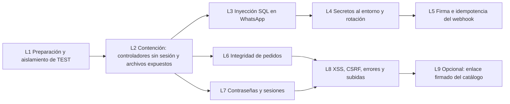

# Fase 3 — Plan de implementación de correcciones de seguridad

> **DESCARTADO (2026-10-21).** La Fase 3 se replanteó: el PHP no se corrige. Ver `docs/FASE_3_CIERRE.md`. Se conserva solo como antecedente.

| Campo | Valor |
|---|---|
| Fecha | 2026-10-21 |
| Basado en | `docs/FASE_3_AUDITORIA_SEGURIDAD.md` (los ID de hallazgo se refieren a ese documento) |
| Pruebas | `docs/FASE_3_PRUEBAS.md` (los ID `T-xx` se refieren a ese documento) |
| Estado | **Propuesto. Ningún lote está autorizado.** Cada lote necesita aprobación explícita antes de empezar. |

---

## 1. Reglas que aplican a todos los lotes

1. **Primero TEST, después PROD.** Cada lote se despliega en `despacha.multilicoreschapinero.com` y se valida con su matriz de pruebas. Pasa a PROD solo con una aprobación explícita.
2. **No se toca PROD directamente.** Nada de editar archivos por FTP en caliente: todo sale de un commit identificado.
3. **El esquema de la base no cambia.** Si alguna corrección necesita un índice o ampliar una columna (`registro.id_wa`, `users.password`), se presenta aparte y se pide autorización.
4. **El formato de los pedidos se conserva:** las columnas, los estados y el JSON de `api/pedido.php` siguen igual. Los campos nuevos solo pueden ser opcionales.
5. **El catálogo y WhatsApp tienen que seguir funcionando:** la URL `categorias.php?idCli=`, las plantillas y el texto de bienvenida no cambian, salvo en el lote 9, que es opcional.
6. **Las reglas comerciales no cambian:** precios por unidad y por paca, promociones y pedidos con total 0.
7. **Cada lote tiene su reversión** (sección 5).
8. **Ningún secreto va al repositorio.** Viven en `sistema/config/.env.<ambiente>` en el servidor, con permisos restringidos, y en un gestor de contraseñas del negocio.
9. **No se cambia ninguna credencial sin conocer todos sus consumidores** (sección 4).
10. **No se prueba nada destructivo en PROD.** En PROD solo se hacen pruebas de humo de solo lectura y un pedido real controlado si el negocio lo autoriza.

## 2. Accesos y dependencias que faltan

| # | Necesidad | Para qué | Quién la provee | La necesita |
|---|---|---|---|---|
| D-1 | Panel de Hostinger: archivos, bases, PHP, cron, respaldos y MySQL remoto | Respaldos, `.env` en el servidor, rotar las claves de las bases, verificar H-04, H-05 y H-10 | Dueño de la cuenta | Lotes 1, 2 y 4 |
| D-2 | Meta Business Manager: app, WABA, System User y webhook | Token nuevo, App Secret, cambio del token de verificación | Administrador de Meta Business | Lotes 4 y 5 |
| D-3 | Configuración del repositorio en GitHub | Verificar si es público (H-02); decidir si se reescribe el historial | Propietario del repositorio | Lote 4 |
| D-4 | Contacto con el dueño del sistema cuyas credenciales están en `enviarWhatsapp.php` | Avisarle para que las cambie | Negocio | Lote 4 |
| D-5 | Dos o tres números de WhatsApp de prueba controlados por el equipo | Lista de números permitidos en TEST | Negocio | Lote 1 |
| D-6 | Cuentas de prueba del admin en TEST: una con clave en texto plano y otra con bcrypt | Probar la migración de claves | Se crean en TEST con autorización | Lote 7 |
| D-7 | Confirmación de reglas comerciales: ¿hay promociones de precio 0?, ¿hay precios negociados fuera del catálogo?, ¿se puede comprar por unidad con `acti_Unidad=0`? | Recálculo de precios | Negocio | Lote 6 |
| D-8 | Autorización para leer el esquema de TEST (`SHOW CREATE TABLE`) | H-07 | Usuario | Lotes 5 y 7 |
| D-9 | Lista de quienes usan el admin y desde qué navegadores o dispositivos | Sesiones y CSRF | Negocio | Lotes 7 y 8 |

## 3. Orden de los lotes y por qué

Se ajustó el orden sugerido (preparación → secretos → autenticación → pedidos → SQL y claves → WhatsApp) por tres razones:

- **La contención va antes que los secretos.** Cerrar los cinco controladores sin sesión y la inyección SQL del webhook elimina los ataques que hoy no necesitan nada. Son cambios pequeños, de bajo riesgo y que no dependen de terceros. Rotar secretos depende de Meta y Hostinger, y conviene hacerlo con el código ya leyendo del entorno.
- **La inyección SQL del webhook va aparte y temprano.** Es crítica, cualquiera la puede explotar por WhatsApp y su corrección es pequeña.
- **Las claves van después de cerrar `UserController`.** Si el login se corrige primero, el POST abierto de `UserController` pasa a ser robo de cuentas.

| Lote | Hallazgos | Esfuerzo aproximado | Riesgo de regresión | Ventana de mantenimiento |
|---|---|---|---|---|
| L1 | SEC-06 (y prepara todo) | 1–2 días | Bajo | No |
| L2 | AUT-01 a AUT-05, SEC-05, GEN-04 | 1 día | Bajo | No (horario de poco tráfico) |
| L3 | SQL-01, SQL-02, SQL-03 | 0,5 día | Bajo | No |
| L4 | SEC-01 a SEC-04 | 1–2 días, más coordinación | Medio | **Sí, corta (15–30 min) para la rotación de la clave de la base de PROD** |
| L5 | WA-01, WA-02, WA-03 | 1 día, más una semana de observación | Medio | No |
| L6 | PRE-01, parte de AUT-06 | 2–3 días, más una o dos semanas de observación | Alto | No para la observación; recomendable para pasar a aplicación |
| L7 | PWD-01, PWD-02, PWD-03, AUT-09, AUT-10 | 1–2 días | Medio | No (avisar al personal) |
| L8 | XSS-01, AUT-07, AUT-08, GEN-01, GEN-02, GEN-03 | 2 días | Medio | No |
| L9 | AUT-06 (fondo) | 2–3 días | Alto | No (con convivencia) |

---

## 4. Estrategia de rotación de credenciales

**Principio:** primero el código lee la credencial **actual** desde el entorno y se verifica. Después se emite la credencial nueva, se reemplaza **solo en el `.env`** y se revoca la anterior. Así la rotación no requiere desplegar código.

| Credencial | Consumidores (todos) | Procedimiento | Corte de servicio | Si algo falla |
|---|---|---|---|---|
| Token de Meta | `WhatsappSender.php`, `enviarWhatsapp.php`, `enviar.php` (muerto) | 1) Código que lee `WHATSAPP_TOKEN`, con el valor actual en `.env`. 2) Crear un token permanente de System User. 3) Ponerlo en `.env.prod` y probar un envío controlado. 4) Revocar el token anterior en Meta. | Ninguno | Volver a poner el token anterior en `.env` **mientras no se haya revocado**; después de revocarlo, solo queda emitir otro |
| Token interno | `enviarWhatsapp.php` (lo valida); `PedidoModel`, `solicitudModel` y `Promo` (lo envían) | Todos están en el mismo servidor y leen el mismo `.env`. Se cambia el valor una vez, así que todos cambian juntos. | Ninguno | Volver al valor anterior en `.env` |
| Token de verificación del webhook | `recepcionWhatsapp.php` y la configuración del webhook en Meta | 1) Nuevo valor en `.env`. 2) En Meta, editar el webhook con el nuevo token y volver a verificarlo. Meta solo lo usa al verificar, así que la recepción de mensajes no se corta. | Ninguno (unos minutos sin poder volver a verificar) | Volver a poner el valor anterior en los dos lugares |
| App Secret (nuevo) | `recepcionWhatsapp.php` | Leerlo de la app de Meta y guardarlo en `.env`. Primero en modo observación (lote 5). | Ninguno | Desactivar la validación con una variable de entorno |
| Clave de MySQL de PROD | `models/database.php` (PDO) y `services/conexion.php` (mysqli), los dos a través de `database.env.php` | **Opción A, preferida si Hostinger lo permite:** crear un usuario nuevo con los mismos privilegios, ponerlo en `.env.prod`, verificar y borrar el usuario anterior. Sin corte. **Opción B:** en la ventana, cambiar la clave en hPanel y actualizar `.env.prod` de inmediato. Corte de 1 a 5 minutos. | A: ninguno. B: minutos | Volver a cambiar la clave en hPanel. **La clave anterior ya no sirve después de cambiarla**, así que hay que mantener el valor nuevo en el gestor de contraseñas antes de hacer el cambio. |
| Clave de MySQL de TEST | Los mismos, en TEST, y `config/.env.dev` local | Igual que PROD, sin ventana | Solo en TEST | Igual |
| Credenciales del otro sistema | Ninguno aquí | Borrar el comentario y avisar al dueño. La rotación la hace él. | — | — |

**Historial de git:** borrar un valor de un archivo **no lo borra del historial**. La rotación deja inútiles los valores expuestos, así que **no es obligatorio reescribir el historial**. Si el repositorio es o fue público (H-02), se decide aparte. Reescribirlo cambia los hashes, obliga a todos a clonar de nuevo y no borra copias que ya existan.

---

## 5. Diferencia entre revertir código, credenciales y datos

| Tipo de cambio | ¿Se revierte con git? | Cómo se revierte |
|---|---|---|
| Código PHP o JS | Sí | Revertir el commit o redesplegar la etiqueta anterior |
| Valores en `.env` del servidor | No | Respaldo del `.env` anterior, guardado fuera del servidor en el gestor de contraseñas |
| Credenciales rotadas en Meta o Hostinger | **No** | Una credencial revocada no vuelve. Se puede emitir otra, pero no recuperar la anterior. |
| Datos escritos por la aplicación (pedidos, claves migradas a bcrypt, registros en `registro`) | **No** | Restaurar desde el respaldo, con pérdida de lo posterior. La migración de claves es irreversible por diseño, pero compatible hacia atrás: el login nuevo acepta los dos formatos. |
| Configuración del webhook en Meta | No | Editarla de nuevo en el panel de Meta |

**Consecuencia:** antes de rotar o de migrar datos, el código revertido **tiene que seguir funcionando** con la credencial nueva y con los datos migrados. Por eso el cargador de entorno y el login compatible con los dos formatos se mantienen en cualquier versión a la que se vuelva.

---

## 6. Detalle por lote

### Lote 1 — Preparación y aislamiento de TEST

- **Objetivo:** poder probar sin riesgo y tener una línea base.
- **Hallazgos:** SEC-06. Además verifica H-02, H-03, H-04, H-05, H-07, H-08 y H-10.
- **Dependencias:** D-1, D-5 y D-8.
- **Archivos:**
  - `sistema/models/PedidoModel.php` (`enviarConfirmacion`), `sistema/models/solicitudModel.php` (`enviarPromo`), `sistema/models/Promo.php` (`enviarPromo`): la URL sale de la configuración.
  - `sistema/services/enviarWhatsapp.php`: modo de envío.
  - `sistema/config/database.env.php` o un `config/app.env.php` nuevo: `APP_BASE_URL` y `WHATSAPP_MODE`.
  - `sistema/config/.env.dev` (solo en el servidor de TEST).
- **Cambios:**
  1. **Respaldos:** copia completa de la base de PROD y de los archivos de `sistema/` desde hPanel, con fecha. Se restaura en un ambiente aislado para comprobar que el respaldo sirve. También se respalda TEST.
  2. Etiqueta git `pre-fase3-baseline` sobre el commit desplegado hoy en PROD. Antes hay que confirmar que PROD coincide con `main`; si no coincide, descargar el PROD actual y compararlo.
  3. La URL de `enviarWhatsapp.php` se arma con el host del ambiente. **En PROD queda exactamente igual que hoy.**
  4. `WHATSAPP_MODE`:
     - `live`: el valor por defecto en PROD; se comporta como hoy.
     - `allowlist`: en TEST; solo envía a los números de D-5.
     - `off`: registra sin enviar.
     - Se aplica en `enviarWhatsapp.php` y en `WhatsappSender.php`, la respuesta del bot, que en TEST solo debe responder a números permitidos.
  5. Inventario de consumidores de cada secreto (sección 4) firmado por el negocio.
  6. Verificación de las hipótesis con solo lectura, previa autorización.
  7. Se corre la **matriz funcional base** (T-01 a T-35) en TEST y se registran los resultados.
- **Pruebas:** T-01 a T-03 y la matriz funcional completa como línea base.
- **Riesgos:**
  - Que PROD no coincida con `main`.
  - Que el respaldo no se pueda restaurar.
  - Que en PROD se quede `WHATSAPP_MODE` mal puesto y se dejen de enviar mensajes. Se mitiga con `live` como valor por defecto si la variable no existe.
- **Reversión:** revertir el commit. Los respaldos no se revierten.
- **Criterios de aceptación:**
  - El respaldo se restaura correctamente.
  - Desde TEST, un pedido a un número que no está en la lista **no** genera envío a Meta y queda en el log como bloqueado.
  - PROD sigue enviando con normalidad (verificado después del despliegue con un mensaje controlado al número del negocio).
- **Ventana:** no.

### Lote 2 — Contención de controladores administrativos y archivos expuestos

- **Objetivo:** que ninguna acción administrativa se pueda ejecutar sin sesión.
- **Hallazgos:** AUT-01 a AUT-05, SEC-05 (bloqueo y sacar el log de git) y GEN-04 (bloqueo).
- **Dependencias:** L1.
- **Archivos:**
  - Nuevo `sistema/controllers/require_admin.php`: un helper que hace `session_start` y valida `$_SESSION['usuario']`. Responde 401 en JSON a las llamadas AJAX y redirige al login a los formularios.
  - Incluirlo al principio de `UserController.php`, `ProductoController.php`, `promoController.php`, `controllerCaja.php` y `pedidoController.php`.
  - Nuevos `.htaccess` en `sistema/`: denegar `*.txt` y `*.log`; denegar `services/enviar.php`, `Routes/`, `controllers/AuthController.php`, `views/reservation-*`, `views/payment.php` y `views/item-*`; impedir ejecutar PHP en `assets/`.
  - Sacar del índice de git `sistema/models/log_envios.txt` y agregar `*.txt` de log a `.gitignore`. El archivo del servidor **no se borra**.
  - `promoController.php`, en `enviarPromo`: la respuesta devuelve solo los totales, sin nombres ni teléfonos. Se revisa si `promo.php` usa esa lista y, si la usa, se le dejan solo los conteos.
- **Comprobado:** estos cinco controladores solo se llaman desde páginas del admin, así que no afecta al catálogo ni a `procesar_telefono_cliente.php`.
- **Pruebas:** T-10 a T-15, T-20 a T-24, T-31 a T-35, T-64, T-65 y T-70 a T-72.
- **Riesgos:**
  - Una página del admin que llame sin enviar la cookie (por ejemplo, una `fetch` con un origen distinto). Se mitiga revisando las llamadas en TEST.
  - Reglas de `.htaccess` incompatibles con el hosting. Se mitiga probando cada regla en TEST.
- **Reversión:** revertir el commit y borrar los `.htaccess` nuevos.
- **Criterios de aceptación:**
  - Sin sesión, las cinco rutas responden 401 o redirigen, **sin efecto en la base**.
  - Con sesión, todas las operaciones del admin funcionan igual.
  - Los `.txt` de log devuelven 403 por HTTP.
- **Ventana:** no.

### Lote 3 — Inyección SQL en WhatsApp

- **Hallazgos:** SQL-01, SQL-02 y SQL-03.
- **Dependencias:** L1. Puede ir en paralelo con L2.
- **Archivos:** `sistema/services/WhatsappSender.php` (las dos consultas), `sistema/services/enviar.php` (las dos consultas, o solo el bloqueo del L2), `sistema/models/ProductoModel.php:112`.
- **Cambios:** `mysqli::prepare` con `bind_param` en las consultas y parámetro con nombre en `obtenerProductosLista`. No cambia ni el esquema ni lo que se guarda.
- **Pruebas:** T-46, T-47 y T-85 a T-87.
- **Riesgos:** que cambie el tipo de dato de `timestamp` o de `fechaHora`. Se mitiga usando `s` (texto) igual que hoy.
- **Reversión:** revertir el commit.
- **Criterios de aceptación:**
  - Un mensaje con comillas y SQL se registra **literalmente** y el bot responde normalmente.
  - Los registros nuevos en `registro` son iguales a los de antes.
- **Ventana:** no.

### Lote 4 — Secretos al entorno y rotación

- **Hallazgos:** SEC-01 a SEC-04.
- **Dependencias:** L1, D-1, D-2, D-3 y D-4.
- **Archivos:** `services/WhatsappSender.php`, `services/enviarWhatsapp.php`, `services/enviar.php`, `services/recepcionWhatsapp.php`, `models/PedidoModel.php`, `models/solicitudModel.php`, `models/Promo.php`, `config/database.env.php`. Nuevo `config/.env.example`, con los nombres de las variables y **sin valores**.
- **Cambios:**
  1. Variables: `WHATSAPP_TOKEN`, `WHATSAPP_PHONE_ID`, `INTERNAL_API_TOKEN`, `WHATSAPP_VERIFY_TOKEN`, `WHATSAPP_APP_SECRET` (para el L5), `APP_BASE_URL` y `WHATSAPP_MODE`.
  2. `database.env.php` sin valores por defecto: si falta la configuración, error genérico y registro en el log.
  3. Borrar el comentario con las credenciales del otro sistema.
  4. Comparar el token interno con `hash_equals`.
  5. Orden del despliegue:
     1. Copiar `.env.prod` al servidor con los valores **actuales**.
     2. Desplegar el código.
     3. Verificar.
     4. Rotar según la sección 4: primero Meta, después el token interno y el de verificación, al final MySQL en la ventana.
  6. Avisar al dueño del otro sistema.
  7. Decidir sobre el historial de git (sección 4).
- **Pruebas:** T-01, T-40 a T-45 y T-60 a T-63.
- **Riesgos:**
  - Que falte el `.env` en el servidor: todo se cae. Se mitiga copiando el `.env` primero y con una página de diagnóstico **interna** (que no muestra valores).
  - Que se revoque el token antes de comprobar el nuevo.
  - Que el `.env` quede accesible por web. Se mitiga con el `.htaccess` del L2 (denegar `.env*`) y con permisos 600.
- **Reversión:** el código se revierte con git, **pero las credenciales rotadas no**. El código revertido no tiene valores por defecto, así que el `.env` tiene que seguir en el servidor. Si se vuelve a una versión **anterior al L4**, que tiene los valores viejos en el código, esa versión **no funcionará** una vez rotadas las credenciales. Por eso **la etiqueta mínima a la que se puede volver después del L4 es la del propio L4**.
- **Criterios de aceptación:**
  - No queda ningún secreto en el código (verificado buscando patrones de token y clave).
  - Funcionan los envíos de WhatsApp, el webhook, el admin y el catálogo.
  - Las credenciales viejas fueron revocadas y una prueba con ellas falla.
- **Ventana:** sí, de 15 a 30 minutos para la clave de MySQL de PROD si no se puede usar la opción A.

### Lote 5 — Firma e idempotencia del webhook

- **Hallazgos:** WA-01, WA-02 y WA-03.
- **Dependencias:** L3, L4 (App Secret) y D-2. Opcionalmente, autorización para un índice único en `registro.id_wa`.
- **Archivos:** `services/recepcionWhatsapp.php`, `services/WhatsappSender.php`, `services/enviarWhatsapp.php`.
- **Cambios:**
  1. Validar `X-Hub-Signature-256` con `hash_hmac('sha256', cuerpo_crudo, WHATSAPP_APP_SECRET)` y `hash_equals`.
     - Modo `WEBHOOK_SIGNATURE_MODE=observe`: registra si la firma es válida, pero procesa igual. Se mantiene una semana.
     - Después `enforce`: responde 401 si no es válida.
  2. Revisar el GET de verificación con `WHATSAPP_VERIFY_TOKEN` y `hash_equals`.
  3. Idempotencia: registrar en `registro` **antes** de enviar y no enviar si ya existe.
  4. Responder 200 enseguida.
  5. Log sin el cuerpo completo: solo el tipo, el id y el teléfono enmascarado.
  6. `enviarWhatsapp.php`: lista de plantillas permitidas, validar el teléfono, reintentar una o dos veces solo ante 429 o 5xx, y quitar el CORS de ngrok.
- **Pruebas:** T-40, T-45, T-46, T-48 y T-88.
- **Riesgos:** si el App Secret está mal, en modo `enforce` no se responde a nadie. Se mitiga con la semana de observación, en la que el 100 % de las firmas reales deben ser válidas.
- **Reversión:** volver el modo a `observe` (sin desplegar) o revertir el commit.
- **Criterios de aceptación:**
  - 100 % de las firmas válidas durante la observación.
  - Un POST sin firma no provoca respuesta en `enforce`.
  - Un evento repetido no genera un segundo mensaje.
- **Ventana:** no.

### Lote 6 — Integridad de pedidos (el servidor decide los precios)

- **Hallazgos:** PRE-01, y la parte de AUT-06 sobre `clienteId` y teléfono.
- **Dependencias:** L2 y D-7.
- **Archivos:** `sistema/models/PedidoModel.php` (`crearPedido` y un método nuevo para resolver el precio), `sistema/api/pedido.php`, `sistema/views/procesar_pedido.php`. Solo lectura de `productos` y `promociones`.
- **Cambios:**
  1. Para cada línea, buscar el producto por `id`: debe existir y estar activo. Si no existe, buscar una promoción activa con ese `id_promocion` o `codigo`.
  2. Precios válidos para `(id, tipo)`:
     - `unidad`: `precio_unidad_producto` si `acti_Unidad` ≠ 0;
     - `paca`: `precio_paca_producto`;
     - más el precio de unidad o paca de las **promociones activas** relacionadas con ese id.
  3. Si el precio recibido está en el conjunto, se usa ese valor **leído de la base**. Si no, se usa el precio de catálogo y se marca la diferencia.
  4. `subtotal = cantidad × precio_servidor`; `ped_total = suma de los subtotales`; `nombre_producto` desde la base; `tipo` solo puede ser `unidad` o `paca`.
  5. `clienteId` solo se acepta si `clientes.cli_telefono` coincide con el teléfono recibido. Si no coincide, se identifica por teléfono como hoy.
  6. `PRICE_ENFORCEMENT=observe`, durante una o dos semanas: guarda lo de hoy y registra las diferencias (pedido, línea, precio recibido, precio del servidor). Después `enforce`.
  7. **No cambia** el JSON que reciben el catálogo ni el admin. Se puede agregar un campo opcional `esPromo` o `promoId` en el catálogo para no depender de que el id coincida; queda propuesto y no es obligatorio.
- **Pruebas:** T-20 y T-25 a T-30 (funcionales), T-80 a T-84 (manipulación) y T-73.
- **Riesgos:**
  - Promociones con `codigo` que no corresponde al id que envía el carrito.
  - Precios cambiados mientras el cliente tiene el carrito abierto: el cliente ve un total distinto del que recibe por WhatsApp. Se mitiga comunicándolo en la confirmación.
  - Reglas comerciales no documentadas.
  - Todo se detecta en la observación antes de aplicar.
- **Reversión:** volver a `observe` (sin desplegar) o revertir el commit. Los pedidos ya creados no se modifican.
- **Criterios de aceptación:**
  - En observación, 0 diferencias en los pedidos legítimos, o cada diferencia explicada y aprobada por el negocio.
  - En `enforce`, un pedido manipulado se guarda con los precios de catálogo o se rechaza, según lo que decida el negocio.
  - Los pedidos con promoción y por unidad o paca dan el mismo total que hoy.
- **Ventana:** no para la observación. Para pasar a `enforce`, recomendable en horario de poco tráfico.

### Lote 7 — Contraseñas y sesiones

- **Hallazgos:** PWD-01, PWD-02, PWD-03, AUT-09 y AUT-10.
- **Dependencias:** **L2 obligatoriamente**, D-6 y H-07 (largo de `users.password` ≥ 60).
- **Archivos:** `controllers/index.php`, `controllers/logout.php`, `controllers/UserController.php`, `models/User.php`, `views/user-update.php`, `views/header.php` (vencimiento por inactividad). Nuevo `config/session.php` con los parámetros de la cookie.
- **Cambios:**
  1. Login compatible con los dos formatos: bcrypt con `password_verify`; texto plano con `hash_equals` y, si coincide, rehash inmediato. Además `password_needs_rehash`.
  2. `session_regenerate_id(true)` al iniciar sesión.
  3. Cookie `HttpOnly`, `Secure` y `SameSite=Lax`.
  4. Vencimiento por inactividad (por ejemplo, 8 horas) y logout que borra la cookie.
  5. Límite de intentos (5 en 15 minutos, por sesión y por archivo temporal) y mensaje genérico, sin detalles de la base.
  6. `user-update`: campo de clave vacío, que solo se cambia si se escribe uno nuevo y se confirma.
  7. Longitud mínima de la clave nueva: 10.
  8. Informe periódico de los usuarios que todavía tienen la clave en texto plano (con un script de solo lectura que muestre conteos, no valores).
- **Pruebas:** T-08, T-09, T-50 a T-57, T-77 y T-78.
- **Riesgos:**
  - Dejar fuera a los usuarios si la detección falla. Se mitiga probando en TEST con los dos tipos de cuenta y teniendo un administrador con acceso a la base listo para restablecer una clave.
  - La cookie `Secure` necesita HTTPS en todos los dominios. Se verifica en TEST.
- **Reversión:** el código se revierte con git. **Las claves ya migradas a bcrypt no vuelven a texto plano**, y el login anterior **no** las acepta. Por eso la reversión de este lote tiene que ser **a una versión que conserve el login compatible**, no al código de antes.
- **Criterios de aceptación:**
  - Los usuarios con clave en texto plano y con bcrypt entran.
  - Después del primer ingreso, la clave queda en bcrypt.
  - Un hash usado como clave no permite entrar.
  - Editar un usuario sin tocar la clave no la cambia.
  - El id de sesión cambia al iniciar sesión.
- **Ventana:** no. Avisar al personal.

### Lote 8 — XSS, CSRF, errores y subidas

- **Hallazgos:** XSS-01, AUT-07, AUT-08, GEN-01, GEN-02 y GEN-03.
- **Dependencias:** L2 y L7 (sesión endurecida).
- **Archivos:**
  - `views/solicitudes.php`, `views/clientes.php`, `views/cartera.php`, `views/promo.php`, `views/Subir_excel_producto.php`, `views/user-*.php`.
  - Los controladores del L2.
  - `api/cliente.php`, `controllers/ajax/guardar_cliente.php`, `controllers/ajax/buscar_cliente.php`, `controllers/buscar_bar.php`.
  - `ProductoController.php`, `promoController.php`, `procesar_pedido.php`, `procesar_telefono_cliente.php`, `api/bootstrap.php`.
  - Nuevo `helpers/csrf.php`.
- **Cambios:**
  1. Escape de salida: `htmlspecialchars` en PHP y `textContent` o una función de escape en JS.
  2. Validar que los filtros de fecha tengan formato `Y-m-d`.
  3. Token CSRF en todos los formularios y llamadas AJAX del admin.
  4. `display_errors=0` y mensajes genéricos.
  5. Validar el tipo real de las imágenes subidas.
  6. Alta pública: límites de longitud y caracteres, y limitar solicitudes; `buscar_bar` devuelve solo el id y el nombre.
  7. CORS restringido al dominio del catálogo y a los orígenes de Capacitor, solo si las pruebas lo confirman.
- **Pruebas:** T-05, T-75, T-76 y T-89 a T-92, más una regresión completa del admin.
- **Riesgos:** algún formulario que se quede sin token deja de funcionar. Se mitiga con `CSRF_MODE=observe` durante unos días.
- **Reversión:** revertir el commit o cambiar los modos a `observe`.
- **Criterios de aceptación:** las cargas de XSS se muestran como texto; los POST sin token se rechazan en `enforce`; no se ven errores técnicos en ninguna respuesta.
- **Ventana:** no.

### Lote 9 (opcional) — Enlace firmado del catálogo

- **Hallazgos:** AUT-06 (fondo).
- **Dependencias:** L4, L5 y aprobación del negocio, porque cambia la experiencia del cliente.
- **Cambios:**
  - `catalogo_whatsapp_link` agrega `&sig=` con un HMAC del teléfono y un vencimiento (por ejemplo, 7 días).
  - El catálogo y la API aceptan enlaces firmados y, durante la convivencia, también los antiguos, registrándolos.
  - Pasado ese periodo, un enlace sin firma o vencido pide escribir de nuevo por WhatsApp.
  - La consulta de cliente devuelve los datos completos solo si la firma es válida.
- **Riesgos:** clientes con enlaces viejos guardados. Se mitiga con la convivencia y con un mensaje claro.
- **Reversión:** volver a aceptar enlaces sin firma con una variable de entorno.

---

## 7. Fuera del alcance de la Fase 3

- Rediseñar la identidad del cliente, las cuentas y el OTP (Fase 2, D-09). Se hace en la plataforma nueva.
- Migrar a .NET o React (Fase 4 en adelante, no autorizada).
- Cambios de esquema: solo con autorización aparte.
- Eliminar código muerto: solo se bloquea; borrarlo requiere autorización.

## 8. Lote recomendado para autorizar primero

**El lote 1 (preparación y aislamiento de TEST),** que es requisito de todos los demás. Inmediatamente después, el **lote 2 (contención)** y el **lote 3 (inyección SQL)**, que son pequeños, de bajo riesgo, y cierran los cuatro riesgos críticos que hoy se pueden explotar sin credenciales. El L2 y el L3 se pueden autorizar juntos, con un despliegue en PROD después de validarlos en TEST.
